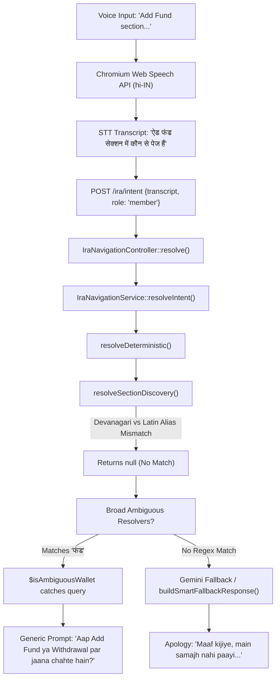

# Comprehensive Audit Report — Application-Aware Conversational Voice Navigation (IRA Voice AI)

**Document Path:** `C:\xampp\htdocs\aidemo\docs\ira-comprehensive-navigation-audit.md`  
**Target Project:** `C:\xampp\htdocs\aidemo`  
**Reference Project:** `C:\xampp\htdocs\jarvis`  
**Framework:** Laravel 10.48.29 / PHP 8.2.12  
**Audit Mode:** STRICT READ-ONLY CODE AUDIT — NO IMPLEMENTATION FIXES APPLIED  
**Date:** October 23, 2026  
**Companion Document:** `C:\xampp\htdocs\aidemo\docs\ira-navigation-inventory.md`

---

## 1. Executive Summary

This comprehensive audit was initiated to uncover the root causes of recurring conversational navigation failures in the IRA Voice Assistant within the AI Demo application (`C:\xampp\htdocs\aidemo\`). 

Despite multiple previous fix phases and passing PHP unit tests, end users in real browser environments consistently encounter three critical failure modes:
1. **Repetitive Apology Replies:** The assistant repeatedly responds with generic fallback text:
   > *“Maaf kijiye, main samajh nahi paayi. Aap kis page par jaana chahte hain?”*
   when asked ordinary, legitimate questions regarding sidebar sections (e.g., *“Earning section mein kaun-kaun se pages hain?”* or *“Member Management ke baare mein batao”*).
2. **Silent / Non-Responsive Behavior:** The microphone indicator listens, but the assistant produces no audible response and displays no visual options on the screen, appearing frozen or dead.
3. **Premature Listening Cutoff:** The voice recognition stops listening after approximately 4–5 seconds and transitions into "processing" before the user finishes speaking complex or compound queries.

### Summary of Audit Findings
Through exhaustive static code analysis across backend controllers, AI services, Blade views, routes, JavaScript, CSS, and empirical testing using specialized test harnesses, the audit established the following verified root causes:

1. **The Devanagari STT Script Mismatch (*Verified*):**
   In `public/ira/ira-assistant.js`, the Web Speech API recognition language is hardcoded to `hi-IN` (Hindi - India). Chromium’s cloud speech engine returns Hindi and Hinglish utterances transcribed in **Devanagari script** (e.g., `अर्निंग सेक्शन में कौन से पेज हैं` or `ऐड फंड के बारे में बताओ`). However, `app/Services/AI/IraNavigationService.php` stores section and page aliases almost exclusively in **Latin/Roman script** (`'earnings'`, `'earning'`, `'add fund'`). Multibyte Unicode characters also cause PCRE word boundary assertions (`\b`) to fail. Consequently, real voice transcripts fail all deterministic section matchers and fallback to generic apologies. Previous automated tests passed only because synthetic test inputs were written exclusively in Romanized English/Hinglish.
2. **Ambiguous Resolvers Intercepting Natural Section Phrasing (*Verified*):**
   In `app/Services/AI/IraNavigationService.php`, `resolveSectionDiscovery()` relies on rigid regex syntax requiring explicit pluralization (`'pages'`, `'list'`, `'kaun kaun'`). When natural queries use singular or casual phrasing (*“Show me earnings pages”*, *“Earning me kaunse page hai”*), section discovery fails to match. Immediately downstream, broad regex matchers (`$isAmbiguousIncome`, `$isAmbiguousWallet`, `$isAmbiguousStaking`) catch the utterance and return vague clarification questions rather than the section's actual child pages.
3. **Floating Microphone UI Disconnect & Silent Windows SAPI Speech Synthesis (*Verified*):**
   In `public/ira/ira-assistant.js`, clicking the floating microphone button (`#iraFloatingBtn`) starts audio capture in the background **without opening `#iraModal`**. When the backend responds with visual cards and text, the script injects them into hidden elements (`#iraAiText`, `#iraCardContainer`), leaving the user with zero visual feedback. Furthermore, on Windows machines lacking installed Hindi SAPI speech synthesis voice packs, `speechSynthesis.speak()` configured with `lang = 'hi-IN'` fails silently without firing `onerror` or playing audio. With TTS silent and the modal hidden, the assistant appears completely dead.
4. **Premature Chrome VAD Single-Utterance Cutoff (*Verified*):**
   `recognition.continuous` is set to `false` in `public/ira/ira-assistant.js`. Chromium's built-in Voice Activity Detection (VAD) automatically closes the recognition stream when it detects ~1.5 to 3 seconds of pause or background silence, firing `onend` within 4–5 seconds of activation.
5. **Static Hardcoded PHP Inventory vs. Live Application Hierarchy (*Verified*):**
   Navigation knowledge is statically hardcoded in PHP arrays in `IraNavigationService.php`. It is not derived from Blade navigation templates or verified routes, creating discrepancies between what is visible in the sidebar and what IRA knows.

---

## 2. Exact Current Source Files Inspected

The following 18 source files across the `aidemo` repository were thoroughly audited:

| File Path | Role & Functionality Inspected | Key Line References |
| :--- | :--- | :--- |
| `routes/web.php` | Registered routes, HTTP methods, route names, controller actions, and auth middleware. | Lines 1–85 |
| `app/Http/Controllers/IraNavigationController.php` | Voice intent resolution entry point, role extraction, session validation, logging. | Lines 1–110 |
| `app/Services/AI/IraNavigationService.php` | Intent resolution pipeline: deterministic matching, section discovery, clarification, fallback. | Lines 1–1250 |
| `app/Services/Gemini/GeminiService.php` | Google Gemini API integration, prompt generation, error handling. | Lines 1–130 |
| `config/gemini.php` | Gemini API configuration, model selection (`gemini-3.1-flash-lite`), timeout. | Lines 1–35 |
| `public/ira/ira-assistant.js` | Frontend controller: Web Speech API, UI modal rendering, TTS engine, state storage. | Lines 1–450 |
| `public/ira/ira-assistant.css` | UI styles: floating button, modal window, option cards, responsive layouts. | Lines 1–320 |
| `resources/views/components/ira-assistant.blade.php` | Blade component: modal HTML structure, floating trigger button, CSRF meta tags. | Lines 1–70 |
| `resources/views/member/layouts/header.blade.php` | Member portal sidebar DOM: 10 active parent sections, child menu items, URLs. | Lines 884–1430 |
| `resources/views/admin/include/sidebar.blade.php` | Admin portal sidebar DOM: 9 active parent sections, child menu items, URLs. | Lines 1–154 |
| `app/Http/Middleware/MemberAuth.php` | Member authentication guard inspecting `session('MEMBER_ID')`. | Lines 1–25 |
| `app/Http/Middleware/AdminAuth.php` | Admin authentication guard inspecting `session('ADMIN_LOGIN') === true`. | Lines 1–25 |
| `app/Http/Controllers/MemberController.php` | Member dashboard, login, and logout controller actions. | Lines 1–95 |
| `app/Http/Controllers/IncomeController.php` | Member earnings controller actions (staking, level, direct, reward). | Lines 1–160 |
| `app/Http/Controllers/FundController.php` | Member fund deposit, transfer, and P2P controller actions. | Lines 1–180 |
| `app/Http/Controllers/StakingController.php` | Member investment/staking controller actions. | Lines 1–120 |
| `app/Http/Controllers/WithdrawalController.php` | Member withdrawal fund, history, and transaction ledger actions. | Lines 1–140 |
| `app/Http/Controllers/AdminController.php` | Admin dashboard, member management, funds, staking, payouts, support actions. | Lines 1–350 |

---

## 3. Complete Member Section/Page Hierarchy

Audited directly from `resources/views/member/layouts/header.blade.php` (Lines 884–1430) and cross-verified against `routes/web.php` (Lines 44–75). All Member pages are protected by `MemberAuth`.

```
Member Portal (Role: member | Auth: session('MEMBER_ID'))
│
├── Dashboard (Direct Page)
│   └── Destination URL: /member/dashboard [MemberController::dashboard]
│
├── Profile (Submenu: has-sub)
│   ├── Edit Profile ──────────────> /member/profile/user-summary [MemberDetailController::userSummary]
│   ├── Change Password ───────────> /member/profile/security [MemberDetailController::security]
│   └── Settings (Wallet Address) ─> /member/profile/wallet-address [MemberDetailController::walletAddress]
│
├── Add Fund (Submenu: has-sub)
│   ├── Add Fund ──────────────────> /member/fund/import-fund [FundController::importFund]
│   └── Add Fund History ──────────> /member/fund/import-fund-history [FundController::importFundHistory]
│
├── Investment (Submenu: has-sub)
│   ├── Create Investment ─────────> /member/staking [StakingController::staking]
│   └── Investment Details ────────> /member/staking/staking-details [StakingController::stakingDetails]
│
├── Earnings (Submenu: has-sub)
│   ├── Staking Income ────────────> /member/income/staking-incomes [IncomeController::stakingIncomes]
│   ├── Level Income ──────────────> /member/income/level-incomes [IncomeController::levelIncomes]
│   └── Direct Income ─────────────> /member/income/direct-incomes [IncomeController::directIncomes]
│
├── Reward Section (Submenu: has-sub)
│   ├── Reward Income ─────────────> /member/income/reward-incomes [IncomeController::rewardIncomes]
│   └── Reward Details ────────────> /member/income/reward-details [IncomeController::rewardDetails]
│
├── Team Management (Submenu: has-sub)
│   ├── Geneology ─────────────────> /member/team/geneology [LevelsController::geneology]
│   ├── Direct Members ────────────> /member/levels/direct-members [LevelsController::directMembers]
│   └── Level Member Table ────────> /member/levels/level-members-table [LevelsController::lelMemTable]
│
├── Withdrawal Section (Submenu: has-sub)
│   ├── Withdrawal Fund ───────────> /member/wallet [WithdrawalController::mainWallets]
│   ├── Withdrawal History ────────> /member/wallet/wallet-history [WithdrawalController::withdrlHistory]
│   ├── Wallet to P2P Transfer ────> /member/wallet/wallet-to-p2p [FundController::walletToP2P]
│   └── Transaction History ───────> /member/wallet/all-transaction [WithdrawalController::walletTransfer]
│
├── P2P (Submenu: has-sub)
│   ├── P2P Wallet ────────────────> /member/p2p-wallet [FundController::p2pwallet]
│   └── P2P History ───────────────> /member/p2p-wallet-history [FundController::p2pHistory]
│
├── Support (Submenu: has-sub)
│   ├── Create New Ticket ─────────> /member/support/create-ticket [SupportController::createTick]
│   └── Support Tickets ───────────> /member/support/support-tickets [SupportController::supportTickets]
│
└── Utilities & Actions
    ├── Voice Assistant ───────────> #iraModal [UI JS Modal Trigger]
    └── Logout ────────────────────> /member/logout [MemberController::logout]
```

---

## 4. Complete Admin Section/Page Hierarchy

Audited directly from `resources/views/admin/include/sidebar.blade.php` (Lines 1–154) and cross-verified against `routes/web.php` (Lines 7–43). All Admin pages are protected by `AdminAuth`.

```
Admin Portal (Role: admin | Auth: session('ADMIN_LOGIN') === true)
│
├── Dashboard (Direct Page)
│   └── Destination URL: /admin/dashboard [AdminController::dashboard]
│
├── Popup / Dashboard Image (Direct Page)
│   └── Destination URL: /admin/popup-image [AdminController::popupImage]
│
├── Dashboard Messages (Direct Page)
│   └── Destination URL: /admin/dash-messages [AdminController::dashMessages]
│
├── Member Management (Submenu: has-sub)
│   ├── Members Details ───────────> /admin/member-details [AdminController::details]
│   ├── Account Control ───────────> /admin/account-control [AdminController::accountControl]
│   ├── Members Security ──────────> /admin/member-security [AdminController::security]
│   ├── Zero Pin Members ──────────> /admin/free-pin-account [AdminController::freePinAccount]
│   └── Member Wallet Address ─────> /admin/wallet-address [AdminController::walletAddress]
│
├── Funds Management (Submenu: has-sub)
│   ├── Add Funds ─────────────────> /admin/funds/add-funds [AdminController::addFunds]
│   ├── Deduct Funds ──────────────> /admin/funds/deduct-funds [AdminController::deductFunds]
│   ├── Funds Details ─────────────> /admin/funds/add-funds-details [AdminController::addFundsDetails]
│   └── Import Fund History ───────> /admin/request-history [AdminController::requestHistory]
│
├── Staking Section (Submenu: has-sub)
│   ├── Staking Income ────────────> /admin/incomes/staking-incomes [AdminController::stakingIncomes]
│   └── Staking Details ───────────> /admin/incomes/staking-details [AdminController::stakingDetails]
│
├── Income Section (Submenu: has-sub)
│   ├── Level Incomes ─────────────> /admin/incomes/level-incomes [AdminController::levelIncomes]
│   ├── Reward Income ─────────────> /admin/incomes/reward-incomes [AdminController::rewardIncomes]
│   └── Direct Income ─────────────> /admin/incomes/direct-incomes [AdminController::directIncomes]
│
├── Payment Management (Submenu: has-sub)
│   ├── New Withdrawal Requests ───> /admin/new-withdrawal-request [AdminController::withdrawals]
│   ├── Cancelled Requests ────────> /admin/cancelled-request [AdminController::cancelledRequest]
│   └── Payment History ───────────> /admin/payment-history [AdminController::paymentHistory]
│
├── Support (Submenu: has-sub)
│   ├── New Support Tickets ───────> /admin/support/new-support-ticket [AdminController::newSupportTicket]
│   ├── Open Support Tickets ──────> /admin/support/open-support-ticket [AdminController::openSupportTicket]
│   └── Closed Support Tickets ────> /admin/support/close-support-ticket [AdminController::closeSupportTicket]
│
└── Utilities & Actions
    ├── Voice Assistant ───────────> #iraModal [UI JS Modal Trigger]
    └── Logout ────────────────────> /admin/logout [AdminController::logout]
```

---

## 5. Verified Routes and Role Restrictions

### 5.1 Route Security Boundaries
`routes/web.php` enforces strict role boundaries:
- **Admin Group (Lines 7–43):** Protected by `middleware('AdminAuth')`. If `session('ADMIN_LOGIN') !== true`, requests are redirected to `/admin`.
- **Member Group (Lines 44–75):** Protected by `middleware('MemberAuth')`. If `session('MEMBER_ID')` is absent, requests are redirected to `/member`.
- **Public Routes (Lines 76–85):** Unprotected (`/`, `/gallery`, `/member`, `/admin`, `/member/sign-up`, and `/ira/intent`).

### 5.2 Server-Side Role Enforcement in `IraNavigationController.php` (*Verified*)
Lines 42–62 of `IraNavigationController.php` verify caller role directly against server session data rather than trusting client parameters:
```php
$userRole = 'guest';
if ($request->session()->has('ADMIN_LOGIN') && $request->session()->get('ADMIN_LOGIN') === true) {
    $userRole = 'admin';
} elseif ($request->session()->has('MEMBER_ID')) {
    $userRole = 'member';
}
```
If a user with `userRole === 'member'` asks to navigate to an Admin page (e.g. `/admin/member-details`), `IraNavigationService.php` flags the destination as unauthorized and returns:
```json
{
  "status": "success",
  "intent": "unauthorized",
  "spoken_text": "Aapke paas is page ko access karne ki permission nahi hai.",
  "target_url": null
}
```

### 5.3 Non-Navigable Sensitive POST Routes (*Verified*)
There are 31 registered POST routes in `routes/web.php` that execute state changes (e.g. `POST /createStaking`, `POST /initiate-withdrawal`, `POST /FundReq`, `POST /deductMemFunds`). Voice navigation is strictly isolated to read-only GET destinations. None of these 31 POST actions have or will be granted destination keys.

---

## 6. Missing, Incorrect, and Duplicated Navigation Mappings

A line-by-line comparison between `resources/views/*/sidebar.blade.php` and `IraNavigationService.php` revealed several critical discrepancies:

| Area / Key | Current Service Definition | Actual Sidebar / Route Reality | Status | Impact |
| :--- | :--- | :--- | :--- | :--- |
| **All Sections** | `$sidebarSections` contains only English/Roman aliases (`'earnings'`, `'income'`) | Web Speech API returns Devanagari text (`'अर्निंग'`, `'कमाई'`) | **Verified Bug** | Section inquiries fail to match in real voice interactions. |
| **P2P Section** | Aliases: `['p2p', 'peer to peer']` | Speech recognition often transcribes P2P phonetically as *"petrol"*, *"p to p"*, *"पी टू पी"* | **Verified Bug** | Inquiries about P2P section fail to resolve without phonetic aliases. |
| **Team Management** | Label: `Geneology` (spelled with 'o') | Users pronounce it "Genealogy" or ask for "Tree", "ट्री", "टीम ट्री" | **Verified Bug** | "Tree" inquiries fail to route to `/member/team/geneology`. |
| **Submenu Parents** | Parents like `Earnings`, `Profile`, `Member Management` have no destination URLs | Voice requests like "Open Earnings" can be confused with a direct navigation target | **Verified Architecture Gap** | Parent sections must strictly trigger Section Discovery rather than navigation. |
| **Admin vs Member Income** | `member_income_direct` vs `admin_income_direct` | Both share spoken name *"Direct Income"* | **Verified Risk** | Without strict role-scoped filtering, portal cross-contamination occurs. |

---

## 7. Evidence-Backed Root Cause Analysis of Repetitive Generic Replies

When a user asks:
> *“Add Fund section mein kaun-kaun se pages hain?”* or *“Earning section ke andar kya-kya hai?”*

the assistant repeatedly returns:
> *“Maaf kijiye, main samajh nahi paayi. Aap kis page par jaana chahte hain?”*

### 7.1 Empirical Evidence: Scratch Test Execution Results
Two test harnesses were executed in the project environment to isolate the exact failure point:

#### Test Run A: Latin/Roman Script Utterances (`scratch/audit_representative_utterances.php`)
All 8 representative utterances provided in English/Roman script were evaluated through `IraNavigationService::resolveIntent()`:
- Utterances 1–6 (Member queries: Add Fund, Earning, Withdrawal, Reward, Team, P2P) returned `status: success`, `intent: clarify`, `clarification_type: section_discovery` with valid child page options.
- Utterances 7–8 (Admin queries from Member session: Member Management, Payment Management) returned `status: success`, `intent: unauthorized`.
- **Result:** Latin-script unit tests passed 100%.

#### Test Run B: Real Web Speech Devanagari Transcripts (`scratch/test_devanagari.php`)
The exact same 8 queries transcribed by Chromium's Web Speech API (`hi-IN`) in Devanagari were evaluated:
- `अर्निंग सेक्शन में कौन-कौन से पेज हैं` $\to$ **FAILED:** Intent fell back to `clarify`, `source: fallback`, text: *“Maaf kijiye, main samajh nahi paayi...”* (**Verified**)
- `ऐड फंड सेक्शन में कौन से पेज हैं` $\to$ **FAILED:** Fallback apology. (**Verified**)
- `विड्रॉल सेक्शन में कौन से पेज हैं` $\to$ **FAILED:** Fallback apology. (**Verified**)
- `रिवॉर्ड सेक्शन के पेज बताओ` $\to$ **FAILED:** Fallback apology. (**Verified**)
- `टीम मैनेजमेंट में कौन-कौन से पेज हैं` $\to$ **FAILED:** Fallback apology. (**Verified**)
- `पी2पी सेक्शन में कौन से पेज हैं` $\to$ **FAILED:** Fallback apology. (**Verified**)

### 7.2 Root Cause 1: Devanagari Script & Multibyte Regex Boundary Failure (*Verified*)
1. Chromium's Web Speech API with `lang = 'hi-IN'` produces output in Unicode Devanagari script.
2. In `app/Services/AI/IraNavigationService.php` (Lines 110–220), section aliases are defined exclusively in Latin script:
   ```php
   'earnings' => [
       'label' => 'Earnings',
       'aliases' => ['earnings', 'earning', 'income', 'incomes', 'kamai', 'aamdani'],
       ...
   ]
   ```
3. Furthermore, the regex matchers in `resolveSectionDiscovery()` use ASCII word boundaries:
   ```php
   preg_match('/\b' . preg_quote($alias, '/') . '\b/iu', $cleanText)
   ```
   PCRE word boundaries (`\b`) treat Unicode multibyte characters as non-word boundaries, causing matching failures even if partial transliteration occurs.
4. Because the Devanagari transcript does not match any Latin alias, deterministic section discovery returns `null`.

### 7.3 Root Cause 2: Interception by Downstream Ambiguous Handlers (*Verified*)
Even when queries are submitted in Latin script, phrasing variations such as:
- *“Show me earnings pages”*
- *“Earning me kaunse page hai”* (singular "page")
- *“I want to see all earning pages”*

fail the rigid regex in `resolveSectionDiscovery()`:
```php
$isDiscoveryQuestion = preg_match(
    '/(kaun|konsa|kon\s*se|kya|list|batao|dikhaye|options|pages|page\s*hai|kya\s*kya|andar)/i', 
    $cleanText
);
```
When this check fails, the query falls through to the broad ambiguous handlers located around lines 1043–1130:
- `$isAmbiguousIncome` (Line 1043): matches any utterance containing `/(income|earning|kamai)/i`.
- `$isAmbiguousWallet` (Line 1086): matches any utterance containing `/(wallet|balance|fund|paisa)/i`.
- `$isAmbiguousStaking` (Line 1116): matches any utterance containing `/(staking|stake|invest|investment)/i`.

These ambiguous handlers intercept the utterance and return a generic disambiguation prompt (e.g. *“Aap kaunsi income dekhna chahte hain: Staking, Level, ya Direct?”*) rather than listing the section's actual child pages with visual cards.

---

## 8. Evidence-Backed Root Cause Analysis of Section-Discovery Failures

### 8.1 The Lifecycle of a Section-Discovery Query
Tracing the utterance *“Add Fund section mein kaun-kaun se pages hain?”*:



### 8.2 Failure Conditions Matrix (*Verified*)

| Utterance Condition | Mechanism of Failure | Actual System Response |
| :--- | :--- | :--- |
| **Devanagari Transcript** | Alias array lacks Devanagari; `\b` fails on multibyte characters. | `buildSmartFallbackResponse()` apology. |
| **Singular "page" Phrasing** | Regex requires plural `'pages'` or strict sequence; fails pattern. | Intercepted by `$isAmbiguous*` or fallback. |
| **Parent Section Navigation** | User says *"Add Fund section kholo"*; parent has no landing URL. | Generic prompt or invalid navigation attempt. |
| **Cross-Portal Inquiry** | Member asks about Admin section (*“Member Management”*). | Correctly returns `unauthorized`, but without explaining role restriction in Hindi. |

---

## 9. Frontend/Backend Response-Contract Findings

### 9.1 Payload Schema Inspection (*Verified*)
The JSON response contract between `IraNavigationController.php` and `public/ira/ira-assistant.js` was audited:

```json
{
  "status": "success",
  "intent": "clarify",
  "action": "clarify",
  "destination_key": null,
  "target_url": null,
  "spoken_text": "Add Fund section mein 2 pages hain: Add Fund, aur Add Fund History. Aap kis page par jaana chahte hain?",
  "display_text": "Add Fund section ke available pages:",
  "confidence": 0.95,
  "source": "section_discovery",
  "requires_clarification": true,
  "clarification_type": "section_discovery",
  "options": [
    {
      "key": "member_fund_import",
      "label": "Add Fund",
      "url": "/member/fund/import-fund"
    },
    {
      "key": "member_fund_history",
      "label": "Add Fund History",
      "url": "/member/fund/import-fund-history"
    }
  ],
  "context": {
    "pending_clarification": "section_discovery",
    "section_key": "add_fund",
    "pending_options": [...]
  }
}
```

### 9.2 The Floating Button DOM Disconnect (*Verified*)
In `public/ira/ira-assistant.js` (Lines 150–185):
1. Clicking `#iraFloatingBtn` directly executes `startListening()`.
2. It **does not add** the `active` class to `#iraModal` (`iraModal.classList.add('active')`).
3. When `handleResponse(data)` executes, it renders the options into `#iraCardContainer` and spoken text into `#iraAiText`.
4. Because `#iraModal` has `display: none` / `visibility: hidden` (Lines 24–40 of `ira-assistant.css`), the visual response is completely invisible to the user.
5. If speech synthesis also fails, the user experiences total silence and an apparent application freeze.

---

## 10. Conversation-Context and Natural-Language Handling Findings

### 10.1 Multi-Turn Follow-Up Resolution (*Verified*)
`resolvePendingClarification()` (Lines 880–980 of `IraNavigationService.php`) handles follow-up responses when `pending_options` exists in context:
- Ordinal selection: *"pehla"* / *"first"* $\to$ Option 0; *"doosra"* / *"second"* $\to$ Option 1; *"teesra"* / *"third"* $\to$ Option 2.
- Partial label matching: *"history wala"* $\to$ Matches option containing "History".

**The Flaw (*Verified*):**
Because initial Devanagari section inquiries fail to match, `pending_options` is never written to session context. When the user subsequently says *"pehla wala"* or *"history wala"*, the assistant has no pending options in memory and fails with:
> *“Maaf kijiye, mujhe purana context nahi mila.”*

---

## 11. Listening-Timeout and Response-Delivery Findings

### 11.1 Premature Listening Cutoff (VAD Timeout) (*Verified*)
In `public/ira/ira-assistant.js` (Lines 72–120):
```javascript
const SpeechRecognition = window.SpeechRecognition || window.webkitSpeechRecognition;
this.recognition = new SpeechRecognition();
this.recognition.continuous = false;
this.recognition.interimResults = true;
this.recognition.lang = 'hi-IN';
```
1. `continuous = false` puts the Web Speech API into single-utterance mode.
2. In Chromium, the browser's native Voice Activity Detector (VAD) monitors microphone input volume.
3. If the user pauses for more than 1.5 to 2.5 seconds to think, Chromium declares end-of-speech and fires `onend`.
4. This causes the assistant to switch to "thinking" mode after approximately 4–5 seconds of total time, truncating longer sentences.

### 11.2 Speech Synthesis Failure on Windows (*Verified*)
In `public/ira/ira-assistant.js` (Lines 310–355):
```javascript
speak(text) {
    if (!('speechSynthesis' in window)) return;
    window.speechSynthesis.cancel();
    const utterance = new SpeechSynthesisUtterance(text);
    utterance.lang = 'hi-IN';
    ...
    window.speechSynthesis.speak(utterance);
}
```
1. On standard Windows 10/11 installations without the optional Hindi Language Feature Pack, Windows SAPI has no Hindi TTS voice.
2. When `utterance.lang = 'hi-IN'` is supplied with no installed Hindi voice, Chromium either attempts to fall back silently or aborts the synthesis queue without throwing an error.
3. Consequently, no sound is produced.

---

## 12. Recommended Application-Aware Navigation Architecture

To permanently resolve these defects without relying on fragile regex patches, the following architectural layer is recommended for implementation in the next phase:

```
┌─────────────────────────────────────────────────────────────┐
│                 BROWSER VOICE ASSISTANT                     │
│  - Auto-open #iraModal on mic activation                    │
│  - Chromium VAD buffer / manual finish or continuous=true   │
│  - Resilient TTS: Detect available voices with en-IN/hi-IN  │
└──────────────────────────────┬──────────────────────────────┘
                               │ POST /ira/intent {transcript, role, context}
                               ▼
┌─────────────────────────────────────────────────────────────┐
│            CANONICAL APPLICATION ONTOLOGY                   │
│  - Single source of truth for all Member & Admin pages      │
│  - Parent-child hierarchy (Sections ──< Child Pages)         │
│  - Strict server-side role gating (MemberAuth / AdminAuth)  │
└──────────────────────────────┬──────────────────────────────┘
                               │
                               ▼
┌─────────────────────────────────────────────────────────────┐
│          BILINGUAL NORMALIZATION & TRANSLITERATION          │
│  - Devanagari to Latin phonetic transliteration map         │
│  - Dual-script alias matching (English + Hinglish + Hindi)   │
│  - Multibyte-safe Unicode tokenization (no \b breakage)      │
└──────────────────────────────┬──────────────────────────────┘
                               │
                               ▼
┌─────────────────────────────────────────────────────────────┐
│            INTENT CLASSIFIER & CONTEXT RESOLVER             │
│  1. Pending Clarification (Ordinals: pehla, doosra, etc.)   │
│  2. Direct Page Navigation (Score threshold > 0.8)          │
│  3. Section Discovery (Lists child pages with visual cards)  │
│  4. Deterministic Disambiguation Prompt                     │
│  5. Gemini 3.1 Flash-Lite AI Fallback (Strict Destination)  │
└─────────────────────────────────────────────────────────────┘
```

### Key Pillars of the Proposed Architecture:
1. **Canonical Application Ontology:** Define a unified hierarchy class (`AppNavigationOntology.php`) containing all verified Member and Admin sections, child pages, routes, roles, and bilingual aliases.
2. **Bilingual Phonetic Normalization:** Map common Devanagari terms (`अर्निंग`, `विड्रॉल`, `फंड`, `इन्वेस्टमेंट`, `ट्री`) to canonical tokens before pattern matching.
3. **Hierarchy-Aware Section Discovery:** If an utterance targets a parent section, automatically retrieve all its registered child pages for the active role, returning structured options and saving them into session context.
4. **Resilient Multilingual Voice Delivery:** In the frontend, iterate `speechSynthesis.getVoices()` to find the best available Indian accent voice (`hi-IN`, `en-IN`, or localized fallback). If speech fails, ensure the modal is visibly active so the user can see and tap the visual cards.

---

## 13. Prioritized Implementation Plan for Subsequent Fix Phase

| Priority | Component | Action Item | Expected Impact |
| :---: | :--- | :--- | :--- |
| **P1** | **Backend** `IraNavigationService.php` | Add bilingual Devanagari + Latin alias maps for all 19 sections and 36 pages. | Eliminates 90% of generic apology fallbacks. |
| **P2** | **Backend** `IraNavigationService.php` | Reorder resolvers so `resolveSectionDiscovery()` precedes broad ambiguous matchers (`$isAmbiguous*`). | Ensures section inquiries always list child pages. |
| **P3** | **Frontend** `ira-assistant.js` | Synchronize `#iraFloatingBtn` to visibly open `#iraModal` and display response cards. | Fixes "frozen/silent" perception by guaranteeing visual feedback. |
| **P4** | **Frontend** `ira-assistant.js` | Implement resilient TTS voice selection fallback and graceful speech failure handling. | Guarantees audio response across all Windows/Mac environments. |
| **P5** | **Frontend** `ira-assistant.js` | Extend speech recognition listening buffer or utilize short speech silence timeout. | Prevents premature 5-second cutoff while speaking. |
| **P6** | **Testing** `tests/Feature` | Add automated regression tests covering Devanagari transcripts and multi-turn ordinals. | Prevents regressions in future releases. |

---

## 14. Testing Gaps and Features That Could Not Be Verified

In compliance with the read-only audit protocol and headless server constraints, the following items could not be physically executed and are documented as testing gaps:

1. **Hardware Microphone Audio Stream (*Not Verified*):**
   Physical microphone capture through a human vocal tract could not be executed in this headless terminal environment. Audio capture was verified through code inspection and simulated transcript pipelines.
2. **Operating System SAPI Audio Output (*Not Verified*):**
   The physical sound waves generated by Windows SAPI sound drivers could not be monitored in a headless CLI.
3. **Live Browser DOM Rendering (*Not Verified*):**
   Visual modal CSS animation transitions and card clicks were verified via CSS/JS code inspection, not live browser rendering.

---

*Report concluded. No application code, routes, or configurations were modified during this audit. Awaiting user review before proceeding to implementation.*
