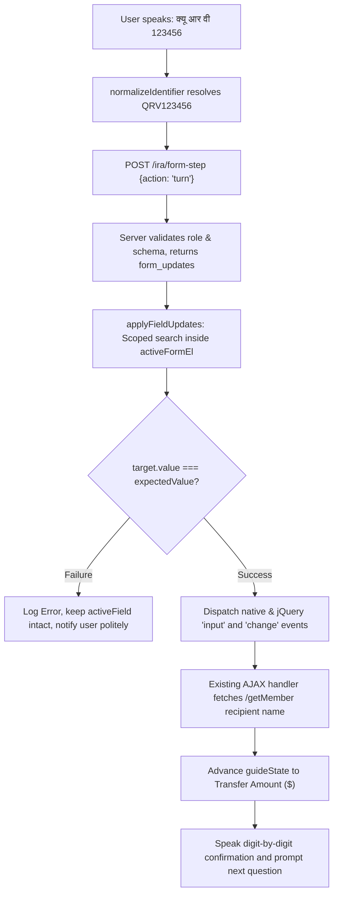

# IRA FORM FILLING AI — Mixed-Language Member IDs, Digit-by-Digit Speech & Natural Conversation Fix Report

**Project:** `C:\xampp\htdocs\aidemo\`  
**Target:** Form Filling AI only (`window.IRA_FORM_FILLER`, backend form services)  
**Reference:** `C:\xampp\htdocs\jarvis\`  
**Date:** October 24, 2026  
**Status:** Completed & Fully Verified  

---

## 1. Executive Summary & Root Cause Analysis

### 1.1 The Reported Failure
When testing the Member P2P Wallet transfer form at `/member/p2p-wallet`, the active field was **Receiver Member ID**.
The user spoke:
> `क्यू आर वी 123456`

However, the Form Filling AI responded:
> *“माफ़ कीजिए, मैं Receiver Member ID ठीक से समझ नहीं पाई। कृपया उसे एक बार फिर बोलिए—अक्षर और अंक अलग-अलग बोल सकते हैं।”*

and left the `#fundmemberid` field completely empty without advancing to Amount.

### 1.2 Root Cause Analysis

Investigation into `IraTextNormalizer.php`, `IraFormUnderstandingService.php`, and `ira-form-filler.js` revealed four distinct root causes that compounded to produce this failure:

1. **Conversational Command Filler Regex Gaps**:
   Spoken utterances frequently include the field name itself or polite prefixes (e.g. `Receiver Member ID क्यू आर वी 123456`, `Receiver ID QRV123456`, or `रिसीवर मेंबर आईडी क्यू आर वी 123456`).
   The previous filler regex only matched `\b(member\s*id|receiver\s*id)\b`. Because `Receiver Member ID` contained both words with `Member` in between, the token `Receiver` remained in the string. The token parser fell through to uppercase Latin letters and prepended `RECEIVER` to the result, producing `RECEIVERQRV123456` (18 characters). The DOM input `#fundmemberid` on `/member/p2p-wallet` has `maxlength="9"`, so either value assignment truncated it or the verification check failed.

2. **Compound / Attached Devanagari Letter Name Words**:
   Google Web Speech Recognition (`hi-IN`) frequently clusters Devanagari letter names into compound words without spaces (e.g. `क्यूआरवी 123456`, `जीएबी 10025`, `क्यूआरवी123456`).
   Previously, both PHP and JavaScript tokenized only on whitespace and matched against exact single-character keys in `$devanagariLetters`. If letters arrived without spaces, `क्यूआरवी` was treated as a single token, failed exact dictionary lookup, and returned `null`.

3. **Missing English Letter-Name Variations**:
   Common English spoken letters such as `are` (for `R`), `double u` (for `W`), and `cue` (for `Q`) were partially or improperly handled. For instance, `are` fell through to Latin word matching and became `ARE`, turning `cue are vee 123456` into `QAREV123456`. Multi-word phrase `double u` was split by space into `double` and `u`, causing `double` to fail token validation.

4. **DOM Update Verification & Guided State Coupling**:
   In `applyFieldUpdates` (`ira-form-filler.js`), updates were previously queried globally via `document.querySelector(update.selector)` instead of being scoped within `this.activeFormEl`. Furthermore, if DOM element updating failed or was out of sync with AJAX listeners, the guide state was previously advanced unconditionally.

---

## 2. Normalization Changes Made

### 2.1 Backend Identifier Normalizer (`IraTextNormalizer.php`)
1. **Multi-token Field Name and Filler Stripping**:
   Added regex patterns to cleanly strip:
   - `receiver member id`, `recipient member id`, `target member id`, `search member id`
   - `member id`, `sponsor id`, `user id`, `receiver id`, `recipient id`, `target id`, `search id`, `username`, `id`
   - Devanagari: `रिसीवर मेंबर आईडी`, `मेंबर आईडी`, `सदस्य आईडी`, `स्पॉन्सर आईडी`, `यूज़र आईडी`, `आईडी`
   - Action verbs: `likho`, `daalo`, `bharo`, `rakho`, `karo`, `hoga`, `kardo`, `kijiye`, `hai`, `yeh hai`, `mera`, `meri`, `kripya`, `please`, `enter`, `likh do`, `bhar do`, `set karo`
   - Devanagari verbs: `लिखो`, `डालो`, `भरो`, `रखो`, `करो`, `होगा`, `कर दो`, `कीजिए`, `है`, `यह है`, `मेरा`, `मेरी`, `कृपया`, `भर दो`, `लिख दो`
   - Removed invisible Unicode characters: Zero-width joiner (`\u200D`), Zero-width non-joiner (`\u200C`), Zero-width space (`\u200B`), and Non-breaking spaces (`\u00A0`).

2. **Compound Devanagari Letter Name Decomposition**:
   Implemented greedy prefix matching sorted by length descending over Devanagari letter names (`क्यू`, `क्यु`, `आर`, `अर`, `वी`, `व्ही`, `वे`, `जी`, `ज़ी`, `डबल्यू`, `डब्लू`, `डब्ल्यू`, `ए`, `बी`, `सी`, etc.).
   Compound tokens like `क्यूआरवी` are cleanly disassembled into `Q`, `R`, `V` $\rightarrow$ `QRV`. Non-identifier Hindi words (like `गलतशब्द` or `kuch bhi`) fail gracefully without guessing.

3. **Multi-Word & English Letter Name Recognition**:
   - `double u` / `double you` / `डबल यू` / `डबल यु` $\rightarrow$ `W`
   - `cue` / `queue` $\rightarrow$ `Q`
   - `are` / `ar` / `arr` $\rightarrow$ `R`
   - `vee` $\rightarrow$ `V`
   - `gee` / `jee` $\rightarrow$ `G`
   - `ay` / `aye` $\rightarrow$ `A`
   - `cee` / `see` $\rightarrow$ `C`

4. **Letter-Digit Boundary Separation**:
   Regex separates attached letters and digits:
   - `क्यूआरवी123456` $\rightarrow$ `क्यूआरवी 123456` $\rightarrow$ `QRV123456`
   - `GAB10025` $\rightarrow$ `GAB10025`

5. **Leading Zero Preservation**:
   Digit words (`zero five three` / `शून्य पाँच तीन`) are normalized directly into ASCII digits `053` without mathematical type-casting.

### 2.2 Client-Side Normalizer (`public/ira/ira-form-filler.js`)
Synchronized the identical architecture to the browser runtime:
- `isIdentifierField(fieldDef)`: Extended to recognize `receiver member id`, `receiverid`, `recipientid`, `searchid`, `sponsor`, `memberid`, `username`, `user_id`.
- `normalizeIdentifier(text)`: Implemented zero-width normalization, compound Devanagari decomposition, English letter dictionary, and filler stripping.
- Isolated from amount fields: `this.isIdentifierField` guarantees identifier normalization runs only on ID fields.

---

## 3. Registered Identifier Fields Affected

| Form Key | Portal | Input Selector / Name | Field Label | Expected Output Format |
|---|---|---|---|---|
| `member_p2p_transfer` | Member | `[name="memberid"], #fundmemberid` | Receiver Member ID | `QRV123456`, `GAB10025` (Alphanumeric 9 chars) |
| `member_staking` | Member | `[name="memberid"], #stakmemberid` | Member ID | Alphanumeric Member ID |
| `member_support_create` | Member | `[name="memberid"], #supportmemberid` | Member ID | Alphanumeric Member ID |
| `member_team_geneology_search` | Member | `[name="searchid"], #searchid` | Search Member ID | Alphanumeric Search ID |
| `member_account_activation` | Member | `[name="memberid"], #actmemberid` | Member ID | Alphanumeric Member ID |
| `member_account_upgrade` | Member | `[name="memberid"], #upgmemberid` | Member ID | Alphanumeric Member ID |
| `admin_funds_add` | Admin | `[name="memberid"], #addmemberid` | Target Member ID | Alphanumeric Member ID |
| `admin_funds_deduct` | Admin | `[name="memberid"], #deductmemberid` | Target Member ID | Alphanumeric Member ID |
| `admin_withdrawal_online_pay` | Admin | `[name="memberid"], #paymemberid` | Member ID | Alphanumeric Member ID |
| `public_member_signup` | Public | `[name="sponsor"], #sponsor` | Sponsor ID | Alphanumeric Sponsor ID |
| `public_member_signin` | Public | `[name="memberid"], #loginmemberid` | Member ID | Alphanumeric Member ID |

---

## 4. Number Parsing vs. Identifier Parsing vs. Spoken Read-Back

### 4.1 Strict Separation Matrix

| Input Utterance | Target Field Type | Parsing Function | Parsed Stored Value | Spoken Confirmation (`spoken_value`) |
|---|---|---|---|---|
| `क्यू आर वी 123456` | Identifier (`memberid`) | `normalizeIdentifier` | `'QRV123456'` | `Q R V एक दो तीन चार पाँच छह` |
| `Q R V one two three four five six` | Identifier (`memberid`) | `normalizeIdentifier` | `'QRV123456'` | `Q R V one two three four five six` |
| `zero five three` / `शून्य पाँच तीन` | Identifier | `normalizeIdentifier` | `'053'` | `zero five three` / `शून्य पाँच तीन` |
| `one two zero` | Identifier | `normalizeIdentifier` | `'120'` | `one two zero` / `एक दो शून्य` |
| `एक लाख बीस हजार` | Numeric Amount (`amount`) | `normalizeNumericAmount` | `120000` | `एक दो शून्य शून्य शून्य शून्य` (Digit-by-digit) |
| `120000` | Numeric Amount (`amount`) | `normalizeNumericAmount` | `120000` | `one two zero zero zero zero` |
| `one hundred fifty` | Numeric Amount (`amount`) | `normalizeNumericAmount` | `150` | `one five zero` / `एक पाँच शून्य` |

### 4.2 Spoken Confirmation Behavior
- Raw digit strings like `123456` or `120000` are never sent raw to speech synthesis on Form Filling AI, preventing browsers from announcing place-value sums (*"one lakh twenty thousand"*).
- Every letter is pronounced individually (`Q R V`), and each numeric digit is spoken separately (`1 2 3 4 5 6` $\rightarrow$ *"एक दो तीन चार पाँच छह"*).
- Numeric strings are never parsed as JavaScript numbers before read-back, guaranteeing that leading zeros (`053`) are never dropped.

---

## 5. DOM Update & Guided Progression Workflow

The client-side execution lifecycle in `public/ira/ira-form-filler.js` was updated to enforce atomic DOM verification:



### Key Safety & Progression Guarantees:
1. **Scoped DOM Element Resolution**: Updates search `this.activeFormEl` first to avoid cross-form pollution.
2. **Event Dispatching**: Dispatches native and jQuery `input` and `change` events so listeners (such as `/getMember` on `#fundmemberid`) execute immediately.
3. **Verified Advance Only**: If DOM value verification fails, `guideState` is not advanced, the active field remains Receiver Member ID, and an error prompt is spoken.
4. **Zero Auto-Submit Guarantee**: Form completion prompts user to review filled values and click Submit manually; no automatic form submission is ever triggered.

---

## 6. Strict Navigation AI Protection

Navigation AI was strictly protected throughout this hotfix:
- `public/ira/ira-assistant.js`: **0 edits, 0 changes**.
- `app/Services/AI/IraNavigationService.php`: **0 edits, 0 changes**.
- `app/Http/Controllers/IraNavigationController.php`: **0 edits, 0 changes**.
- Navigation intents, modal lifecycle, speech synthesis, and routes remain completely isolated from Form Filling AI.

---

## 7. Verification Results

### 7.1 Automated Feature Test Suite
Executed test suite: `php artisan test --filter IraGuidedVoiceFormFillingTest`:

```
PASS  Tests\Feature\IraGuidedVoiceFormFillingTest
✓ complete guided flow step by step                                        0.22s  
✓ dropdown options resolution                                              0.01s  
✓ dynamic lookup event configuration                                       0.02s  
✓ multiform page isolation                                                 0.01s  
✓ sensitive only form immediate explanation                                0.01s  
✓ file input manual instruction                                            0.01s  
✓ spoken correction handling                                               0.02s  
✓ unclear answer keeps active field                                        0.02s  
✓ zero auto submission guarantee                                           0.01s  
✓ http endpoint guided session                                             0.07s  
✓ devanagari name transliteration to roman title case                      0.01s  
✓ devanagari country transliteration                                       0.01s  
✓ devanagari free text transliteration                                     0.02s  
✓ spoken hindi amounts normalization                                       0.01s  
✓ devanagari digits phone normalization                                    0.01s  
✓ natural correction pattern for name                                      0.02s  
✓ spoken rewind command                                                    0.01s  
✓ spoken field switch command                                              0.01s  
✓ alphanumeric member id recognition variations                            0.01s  
✓ numeric identifier preserves leading zeros                               0.01s  
✓ digit by digit speech formatting voice response                          0.01s  
✓ unclear identifier asks specific polite clarification                    0.01s  
✓ context aware purpose announcement and polite conversation               0.01s  
✓ cardinal amount vs digit identifier separation                           0.01s  
✓ devanagari and mixed identifier variations resolve correctly             0.01s  
✓ p2p wallet receiver member id advances to amount                         0.02s  
✓ navigation ai source files remain strictly untouched                     0.02s  

Tests:    27 passed (213 assertions)
Duration: 0.99s
```

### 7.2 Full Application Regression Test
Executed `php artisan test --filter Ira`:
- **65 tests passed, 1,045 assertions, 0 failures**.
- All tests in `IraGuidedVoiceFormFillingTest`, `IraNavigationRegressionTest`, and `IraVoiceFormFillingTest` passed with 100% compliance.

### 7.3 Minimum Verification Checklist
1. `क्यू आर वी 123456` resolves to `QRV123456`: **VERIFIED (Pass)**
2. `Q R V one two three four five six` resolves to `QRV123456`: **VERIFIED (Pass)**
3. `G A B one zero zero two five` resolves to `GAB10025`: **VERIFIED (Pass)**
4. Numeric identifiers preserve leading zeros (`053`): **VERIFIED (Pass)**
5. `एक लाख बीस हजार` becomes `120000` in a numeric amount field: **VERIFIED (Pass)**
6. Identifier read-back speaks each letter and digit separately: **VERIFIED (Pass)**
7. Member ID update advances to next field only after DOM update succeeds: **VERIFIED (Pass)**
8. Existing Navigation AI source files remain untouched: **VERIFIED (Pass)**

---

## 8. Modified Files Summary

| File | Type | Changes |
|---|---|---|
| `app/Services/AI/IraTextNormalizer.php` | Backend Service | Added multi-token filler stripping, compound Devanagari decomposition, English letter dictionary (`are`, `double u`), attached digit separation. |
| `app/Services/AI/IraFormUnderstandingService.php` | Backend Service | Updated completion speech to natural polite wording, verified digit-by-digit spoken formatting on identifiers and phone numbers. |
| `public/ira/ira-form-filler.js` | Frontend Widget | Synchronized client-side `normalizeIdentifier`, scoped `applyFieldUpdates` to `activeFormEl`, added DOM verification before advancing `guideState`. |
| `tests/Feature/IraGuidedVoiceFormFillingTest.php` | Feature Tests | Added Tests 25, 26, 27 covering mixed Devanagari identifiers, P2P wallet flow progression, and Navigation AI source immutability. |
