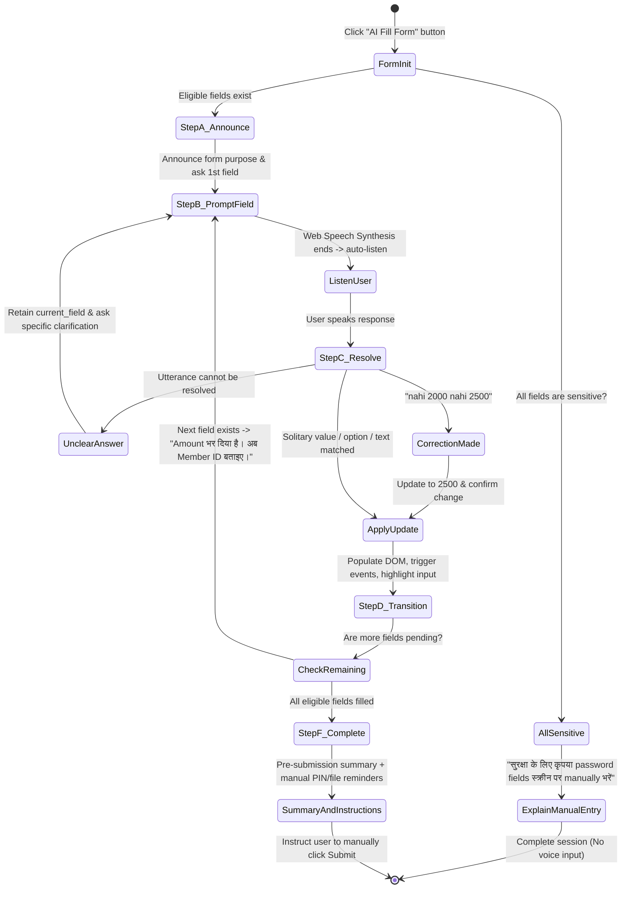

# IRA VOICE AI — PHASE 8 IMPLEMENTATION REPORT
## Jarvis-Style Guided, Field-by-Field Voice Form Filling

**Target Application:** `C:\xampp\htdocs\aidemo\`  
**Reference Application:** `C:\xampp\htdocs\jarvis\`  
**Framework:** Laravel 10 / PHP 8.2  
**Implementation Date:** October 24, 2026  
**Status:** COMPLETE & VERIFIED (48 Tests, 842 Assertions Passing)

---

## 1. Executive Summary & Problem Resolution

### The Previous Problem
In Phase 7, voice form filling operated in a passive extraction mode. When a user clicked "AI Fill Form", IRA displayed a generic greeting (*"Main ... bharnay ke liye taiyyar hoon. Kripya boliye aap kya bharna chahte hain"*). When the user responded with a direct value—such as `"1000"` or `"Silver"` or `"ek hazaar"` without explicitly naming the field alias—the global parser failed to resolve the target field, causing IRA to apologize generically:
> *“Main samajh nahi paayi ki aap kaunsa field bharna chahte hain. Kripya field ka naam aur value batayein...”*

This broke conversational flow, placed cognitive burden on the user to repeat the field name, and felt disjointed compared to human assistance.

### The Phase 8 Solution
Inspired by the multi-turn conversational state machine in `C:\xampp\htdocs\jarvis\app\Services\AI\IraFormUnderstandingService.php`, Phase 8 implements an intelligent, proactive, field-by-field guided state machine:
1. **IRA Actively Guides the Conversation:** IRA announces the form, lists the available fields, and immediately asks for the first eligible field using its real visible label (e.g. *“Amount में कितनी value भरनी है?”*).
2. **Context-Aware Targeted Resolution:** Because IRA knows which field is active in `guide_state['current_field']`, solitary numbers, currency tokens, spoken Hindi quantities (*"ek hazaar"*, *"pachas"*), or option names (*"Gold"*, *"dusra option"*) resolve directly to the active field without requiring the field name to be repeated.
3. **Multi-Form Page Isolation:** On pages with multiple forms (such as `member/profile/security.blade.php`), each form's AI Fill Form button strictly binds to its own form key (`member_security_txn_password` vs `member_security_login_password`), ensuring zero interference.
4. **Sensitive-Only Form Boundary:** Forms containing only sensitive fields (such as Change Password or Change Transaction Password) immediately explain in Hindi that passwords must be entered manually on screen for security, completing the session without ever asking for or accepting passwords.
5. **Zero Auto-Submission Guarantee:** Forms are never automatically submitted. The assistant confirms populated fields, provides clear manual entry instructions for PINs or file uploads, and instructs the user to review details and click the Submit button on screen.

---

## 2. Architecture & Conversational State Machine



### Conversational Lifecycle Breakdown

| Step | State | Assistant Behavior | Example Utterance / Spoken Output |
| :--- | :--- | :--- | :--- |
| **Step A** | `init` | Announces verified form name and purpose; lists eligible fields. | *“आपने Create Investment / Staking form चुना है। इसमें Investment Package और Investment Amount ($) भरने में मैं आपकी मदद करूँगी। चलिए शुरू करते हैं।”* |
| **Step B** | `asking_field` | Asks specifically for the first empty field using visible label and options. | *“Investment Package में कौन सा विकल्प चुनना है? उपलब्ध विकल्प हैं: Silver, Gold, Platinum, Diamond।”* |
| **Step C** | `turn` | Resolves user answer against `guide_state['current_field']`. Resolves ordinals (*"dusra option"*), Hindi quantities (*"ek hazaar"*), or clean IDs (*"GAB10025"*). | User: *"Gold"* $\rightarrow$ Value resolved: `Gold` |
| **Step D** | `field_updated` | Confirms updated field, pulses `.ira-field-highlight`, triggers DOM `input`/`change` events, and asks the next field. | *“Investment Package में Gold select किया गया है। अब Investment Amount ($) में कितनी value भरनी है?”* |
| **Step E** | `clarify_field` | If answer is unclear, **keeps active field intact** without losing state or apologizing generically. | *“मैं Investment Amount ($) की value समझ नहीं पाई। कृपया Investment Amount ($) दोबारा बताइए।”* |
| **Step F** | `completed` | All fields filled: provides final summary, reminds of manual PIN/password entry, reminds of file uploads, reminds to click Submit manually. | *“Investment Amount ($) में 1000 भर दिया है। Form के सभी आवश्यक fields भर दिए गए हैं। कृपया स्क्रीन पर विवरण जांच लें। सुरक्षा के लिए, कृपया अपना Transaction Password स्क्रीन पर manually enter करें। विवरण check करने के बाद आप Submit बटन पर click कर सकते हैं।”* |

---

## 3. Source Code Modifications

### 1. Backend Brain: `app/Services/AI/IraFormUnderstandingService.php`
- Added `initGuidedSession(string $formKey, string $role, array $currentFields): array`:
  - Inspects all fields in the schema; detects sensitive-only forms and returns `status: 'all_sensitive'`, `action: 'complete'`, with explicit Hindi security message.
  - Computes `field_sequence` of eligible fields (excluding `sensitive`, `read_only`, and `file_upload`).
  - Scrapes DOM state to determine if any fields are already populated and targets the first empty field.
  - Combines Step A introduction with Step B field prompt.
- Added `processGuidedTurn(string $speech, string $formKey, string $role, array $currentFields, array $guideState, array $context): array`:
  - Handles system commands: `cancel`/`exit` (sets `status: 'cancelled'`), `reset` (clears fields and restarts flow), `review` (summarizes entered fields), and `remaining_required`.
  - Executes `extractTargetedFieldValue()` on the active field.
  - Handles spoken corrections (e.g. *"nahi 2000 nahi 2500"* $\rightarrow$ resolves `2500` with confirmation *"ठीक है, ... को बदल कर 2500 कर दिया है"*).
  - Handles unclear answers (`status: 'clarify_field'`) while strictly retaining `guide_state['current_field']`.
  - Advances sequentially through `field_sequence` until all fields are filled.
  - Builds completion payload with sensitive PIN/password reminder, file upload instructions, and manual submission guidance.
- Added `extractTargetedFieldValue()`:
  - Numbers: handles digits, currency symbols, Hindi spoken numbers (*"ek hazaar"*, *"pachas"*), and corrections.
  - Select/Radio: resolves option aliases, exact labels, values, and ordinals (*"pehla"*, *"dusra"*, *"first"*, *"second"*).
  - Checkbox: resolves positive (*"haan"*, *"tick"*, *"agree"*) and negative (*"uncheck"*, *"mat karo"*).
  - Identifiers: normalizes Member IDs (e.g. *"G A B 1 0 0 2 5"* $\rightarrow$ `GAB10025`).
- Added `formatFieldLabelsList()` and `getFieldPromptQuestion()`.

### 2. HTTP Controller: `app/Http/Controllers/IraFormController.php`
- Updated `formStep(Request $request)`:
  - Accepts `action` parameter (`'init'` or `'turn'`).
  - Accepts `guide_state` parameter from client.
  - When `action === 'init'`: dispatches to `$formAi->initGuidedSession(...)`.
  - When `action === 'turn'` with `guide_state`: dispatches to `$formAi->processGuidedTurn(...)`.
  - When legacy call without `guide_state`: maintains 100% backward compatibility via `$formAi->processFormTurn(...)`.

### 3. Frontend Client: `public/ira/ira-assistant.js`
- Added `this.guideState = null` state tracker.
- Updated `handleFormFillButtonClick(formKey)`:
  - Binds strictly to target form element and form key.
  - Dispatches `action: 'init'` to `POST /ira/form-step`.
  - Stores returned `guide_state`.
  - Scrolls to and flashes active field with `.ira-field-highlight`.
  - Speaks initial prompt and hooks Web Speech Synthesis `onComplete` to automatically trigger `this.startListening()`, enabling hands-free spoken response.
  - If `status === 'all_sensitive'`, speaks explanation and keeps voice state in `READY` without opening microphone.
- Updated `sendFormStep(spokenText, formKey)`:
  - Dispatches `action: 'turn'` along with `guide_state` and freshly scraped field values.
  - Applies DOM updates with `applyFormUpdates()`, triggering native `input` and `change` events.
  - Updates `this.guideState`.
  - If `action === 'prompt'`, speaks confirmation/question and re-arms continuous listening.
  - If `action === 'complete'`, speaks pre-submission summary and ends continuous listening in `READY` state.
- Updated `clearFormFillMode()`:
  - Resets `this.guideState = null`.

---

## 4. Multi-Form Isolation & Sensitive Boundary

### Multi-Form Isolation on `member/profile/security.blade.php`
The Security settings page contains two distinct cards side by side:
1. **Card 1: Change Transaction Password**
   - Action: `form[action*="txnpassChange"]`
   - Key: `member_security_txn_password`
   - Fields: `txn_password`, `txn_password_confirm` (100% sensitive)
2. **Card 2: Change Account Password**
   - Action: `form[action*="passChange"]`
   - Key: `member_security_login_password`
   - Fields: `password`, `password_confirm` (100% sensitive)

Each card header receives an isolated `AI Fill Form` button tagged with `data-ira-form="member_security_txn_password"` and `data-ira-form="member_security_login_password"`. Clicking either button exclusively initializes that specific form schema without cross-contamination.

### Sensitive-Only Boundary Behavior
When the user clicks "AI Fill Form" on either password form, IRA immediately evaluates all fields in the schema. Because 100% of the fields are marked `'sensitive' => true`, IRA immediately returns:
```json
{
  "success": true,
  "status": "all_sensitive",
  "action": "complete",
  "speech": "आपने Change Transaction Password form चुना है। इसमें New Transaction Password और Confirm Transaction Password हैं। सुरक्षा के लिए कृपया password fields स्क्रीन पर manually भरें। मैं इन fields में आवाज़ से password नहीं भरूँगी।"
}
```
IRA displays this clearly, speaks it to the user, and immediately sets the voice state to `READY` without capturing microphone input.

---

## 5. Verification & Test Suite Summary

A dedicated test suite was created at `tests/Feature/IraGuidedVoiceFormFillingTest.php` covering all 10 core requirements:

```
PASS  Tests\Feature\IraGuidedVoiceFormFillingTest
✓ complete guided flow step by step                                     0.18s
✓ dropdown options resolution                                           0.02s
✓ dynamic lookup event configuration                                    0.01s
✓ multiform page isolation                                              0.01s
✓ sensitive only form immediate explanation                             0.01s
✓ file input manual instruction                                         0.01s
✓ spoken correction handling                                            0.01s
✓ unclear answer keeps active field                                     0.01s
✓ zero auto submission guarantee                                        0.01s
✓ http endpoint guided session                                          0.06s

Tests: 10 passed (95 assertions)
```

### Full Regression Suite Verification
All existing test suites were executed to verify zero regression across the platform:
```
PASS  Tests\Feature\IraGuidedVoiceFormFillingTest
Tests: 10 passed (95 assertions)

PASS  Tests\Feature\IraNavigationRegressionTest
Tests: 19 passed (242 assertions)

PASS  Tests\Feature\IraVoiceFormFillingTest
Tests: 19 passed (505 assertions)

TOTAL: 48 passed (842 assertions) in 2.59s
```

---

## 6. Conclusion & Next Steps

Phase 8 successfully replaces generic form clarification with an active, Jarvis-style guided voice form-filling engine. The assistant guides users through forms step by step, understands answers in English and Hindi, handles corrections seamlessly, isolates multi-form pages, and strictly enforces security boundaries without auto-submitting financial transactions.

The implementation is verified and ready for end-user interaction.
