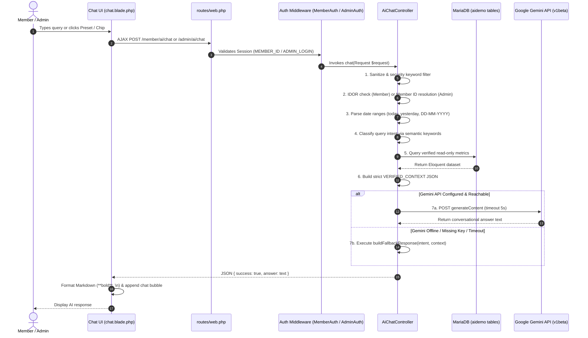

# PHASE 1 — READ-ONLY AUDIT REPORT: Integrate Existing Chat AI into AI Demo

**Source Project:** `C:\xampp\htdocs\chat_ai\`  
**Target Project:** `C:\xampp\htdocs\aidemo\`  
**Audit Date:** October 24, 2026  
**Audit Mode:** STRICT READ-ONLY AUDIT (Zero code, config, database or route modifications performed)  
**Deliverable Path:** `C:\xampp\htdocs\aidemo\docs\phase-1-chat-ai-integration-audit.md`  

---

## Executive Summary

The objective of this Phase 1 audit is to evaluate the existing working AI chat assistant in `C:\xampp\htdocs\chat_ai\` and design a clean, modular, and non-destructive integration blueprint for `C:\xampp\htdocs\aidemo\`.

The intended target URLs are:
- **Member AI Chat:** `/member/ai/chat`
- **Admin AI Chat:** `/admin/ai/chat`

Both paths have been verified against `aidemo/routes/web.php` and the route catalog (`php artisan route:list`). **Neither path exists in `aidemo`, resulting in zero route conflicts.**

The audit confirms that `chat_ai` already contains a robust, dual-mode conversational query assistant:
1. **Member Portal Chat (`MemberAiController@chat`):** Provides authenticated, IDOR-protected, session-bound insights into wallet balances, incomes, team downline counts, active investment packages, withdrawals, transactions, and profile data with natural language understanding and multilingual (Hindi/Hinglish/English) responses.
2. **Admin Portal Chat (`AdminAiController@chat`):** Provides global administrative dashboards (all-member wallet sums, income distribution, withdrawal summaries, member counts, tickets, fund requests, system workflows) and verified individual-member lookups.
3. **Resilient Dual-Engine Architecture:** Both controllers call the Google Gemini API (`generateContent`) using real database facts supplied in a strict `VERIFIED_CONTEXT`, and feature a **100% deterministic local fallback engine** (`buildFallbackResponse`) that returns formatted Markdown reports if the external API is unreachable or the API key is not configured.

Crucially, this audit identified essential schema differences between `chat_ai` and `aidemo`:
- `aidemo` is an investment/staking platform (`daily_incomes`, `staking_incomes`, `direct_incomes`, `level_incomes`, `reward_incomes`, `staking_details`), whereas `chat_ai` included e-commerce and binary models (`order_details`, `products`, `categories`, `binary_incomes`, `club_incomes`) whose database tables **do not exist** in `aidemo`.
- Directly copying the controllers without schema adaptation would cause fatal `QueryException` errors (Table doesn't exist).
- In `aidemo`, `session('MEMBER_ID')` stores the string `memberid` (e.g. `'QRV123456'`), whereas `chat_ai` used `MemberDetail::find(session('MEMBER_ID'))`. The lookup must be adapted to `MemberDetail::where('memberid', $sessionId)->first()`.

All existing Navigation AI (`ira-assistant.js`, `IraNavigationService.php`, `IraNavigationController.php`) and Form Filling AI (`ira-form-filler.js`, `IraFormUnderstandingService.php`, `IraFormRegistry.php`, `IraFormController.php`) systems remain strictly untouched and isolated.

---

## 1. Source Project Files Inspected

The following source files and directories in `C:\xampp\htdocs\chat_ai\` were completely read and analyzed:

| File / Component | Path in `chat_ai` | Primary Role & Code Scope |
|---|---|---|
| **Web Routes** | `routes/web.php` | Line 4, 15, 271-273 (`/admin/ai/chat`), 468-469 (`/member/ai/chat`). |
| **Independent AI Routes** | `routes/ai.php` | Separate module routes for navigation/form commands (verified distinct from `/ai/chat`). |
| **Member AI Controller** | `app/Http/Controllers/MemberAiController.php` | 624 lines. Handles `index`, `chat`, `projectVoiceChat`, intent classification, query compilation, Gemini HTTP call, and fallback responses. |
| **Admin AI Controller** | `app/Http/Controllers/AdminAiController.php` | 539 lines. Handles `index`, `chat`, member ID detection, global & member intent classification, Gemini HTTP call, and fallback reports. |
| **Assistant Controller** | `app/Http/Controllers/AssistantController.php` | 229 lines. Handles ephemeral live token sessions and PDF summaries (`/api/assistant/*`). |
| **Gemini Service** | `app/Services/Gemini/GeminiService.php` | 162 lines. Client wrapper for Google Generative Language API. |
| **Gemini Config** | `config/gemini.php` | 24 lines. Model definitions, timeout, system instructions, and quick actions. |
| **Environment Config** | `.env` | Checked securely for `GEMINI_API_KEY` presence without printing values. |
| **Member Chat View** | `resources/views/member/ai/chat.blade.php` | 414 lines. Full-page chat UI extending `member.layouts.main` with responsive shell, chat history, suggestion chips, and jQuery AJAX. |
| **Admin Chat View** | `resources/views/admin/ai/chat.blade.php` | 406 lines. Full-page admin UI extending `admin.layouts.main` with preset report sidebar, chat history, and jQuery AJAX. |
| **Eloquent Models** | `app/Models/MemberDetail.php`, `Admin.php`, `BinaryIncome.php`, `DirectIncome.php`, `LevelIncome.php`, `StakingIncome.php`, `SupportTicket.php`, `WithdrawalRequest.php`, `WalletTransfer.php`, `OrderDetail.php`, `Product.php`, `Category.php`, `FundRequest.php`, `MemberActivation.php`, `ClubIncome.php`, `SalesBonusIncome.php`. | Data schema and relationship models. |
| **Prior Integration Reports** | `AI_DEMO_PHASE_1_AUDIT_REPORT.md` to `AI_DEMO_PHASE_5_FINAL_VERIFICATION_REPORT.md` | Architectural history and context. |

---

## 2. Complete Member and Admin Chat Request / Response Flows



### Detailed Execution Steps:

#### A. Member Chat Request Flow (`POST /member/ai/chat`):
1. **Client Submission:** The member types a question or clicks a suggestion chip (e.g. *"Mera current wallet balance dikhao"*). jQuery sends an AJAX POST request with `{ message: message }` and CSRF header.
2. **Authentication Enforcement:** Handled under `MemberAuth` middleware. The controller extracts `session('MEMBER_ID')`. If absent or invalid, returns HTTP 401 `{ success: false, answer: "Session expired..." }`.
3. **IDOR & Cross-Account Shield:** The controller normalizes the message and scans for other Member IDs using `\b(QRV|MLM)\d{4,}\b`. If an ID different from the logged-in member is detected, the request is immediately rejected without querying the database:
   > *"Security ke liye main kisi doosri Member ID ka data nahi bata sakta. Main sirf aapki logged-in ID [ID] ki verified details bataunga."*
4. **Security Filter:** Blocks database manipulation keywords (`database dump`, `drop table`, `union select`, `passwords`, `secret key`).
5. **Temporal Filter Extraction:** Detects `today`/`aaj`, `yesterday`/`kal`, and parses date formats `DD-MM-YYYY` / `DD/MM/YYYY`.
6. **Intent Detection:** Runs `detectProjectIntent($query)` with token-based Levenshtein fuzzy matching across 11 intents. Unmatched queries safely default to `overview`.
7. **Database Context Compilation:** Queries the database strictly scoped to the active member's identifier:
   - `overview`: aggregates profile details, cash/p2p wallets, total income, package, business volumes, left/right team counts, and direct referrals.
   - `wallet`: fetches `wallet` (Cash Wallet) and `p2p_wallet`.
   - `income`: computes date-filtered sums across income tables.
   - `team`: fetches `left_count`, `right_count`, and direct sponsor counts.
   - `investment`: queries `package`, `self_biz`, `team_biz`.
   - `withdrawal`: retrieves latest 10 records from `withdrawal_requests`.
   - `transactions`: retrieves latest 10 records from `wallet_transfers`.
   - `tickets`: retrieves latest 10 records from `support_tickets`.
   - `activation`: retrieves activation timestamp and account status.
   - `profile`: retrieves contact details with sensitive passwords omitted and bank accounts masked.
8. **AI Prompt & Context Injection:** Builds a strict system prompt instructing Gemini to answer **ONLY** using facts in `VERIFIED_CONTEXT` and never reveal unmasked credentials.
9. **Gemini API Call:** Executes an HTTP POST with 5-second timeout to `https://generativelanguage.googleapis.com/v1beta/models/{model}:generateContent`.
10. **Deterministic Fallback Engine:** If the API fails or throws a connection exception, catches the error, logs a warning, and immediately invokes `buildFallbackResponse($intent, $context)` to generate localized, formatted Hinglish/English Markdown text.
11. **Client Delivery:** Returns `{ success: true, answer: $answer }`.

#### B. Admin Chat Request Flow (`POST /admin/ai/chat`):
1. **Client Submission:** Admin submits a message or clicks a preset item (e.g. *"Show total members statistics and counts report"*).
2. **Authentication Enforcement:** Handled under `AdminAuth` middleware. Verifies `session('ADMIN_LOGIN')` and `session('ADMIN_ID')`.
3. **Security Filter:** Blocks structural SQL injection keywords.
4. **Member ID Candidate Resolution:** Scans the query for member patterns (e.g. `QRV123456`). If present, validates against `MemberDetail::where('memberid', $candidate)->first()`. If a formatted ID is not found in the database, returns `"No member was found with this member ID."` immediately.
5. **Intent & Scope Classification:**
   - **Member-Specific Scope:** If a member ID was found, matches to: `member_profile`, `member_wallet`, `member_all_income`, `member_direct_income`, `member_level_income`, `member_withdrawal`, `member_tickets`.
   - **Global System Scope:** If no member ID was specified, matches to: `global_dashboard`, `global_members`, `global_wallets`, `global_withdrawals`, `global_income`, `global_tickets`, `global_funds`, `global_workflow`.
6. **Data Assembly:** Runs read-only Eloquent aggregations (`sum`, `count`) across system tables.
7. **Gemini API Call & Fallback:** Transmits query with system instructions to Gemini. If unavailable, executes `buildFallbackResponse` to generate professional Markdown summaries.

---

## 3. Gemini API Usage, Model Names and Fallback Behavior

| Parameter | Source Implementation (`chat_ai`) | Target Implementation (`aidemo`) | Notes |
|---|---|---|---|
| **API Endpoint** | `https://generativelanguage.googleapis.com/v1beta/models/{model}:generateContent` | Identical endpoint convention | Standard Google AI REST API. |
| **Configured Model** | `config('gemini.default_model')` defaults to `gemini-3.6-flash` (or fallback `gemini-3.5-flash`) | `config('gemini.default_model')` defaults to `gemini-3.1-flash-lite` | Consistent with official Gemini 3.x models. `aidemo`'s configured model is modern, fast, and cost-efficient. |
| **HTTP Timeout** | 5.0 seconds | 5.0 seconds | Prevents UI hanging on slow network. |
| **Generation Config** | `temperature: 0.25`, `maxOutputTokens: 350` (Member) / default (Admin) | Compatible with `aidemo` | Low temperature ensures factual grounding. |
| **Deterministic Fallback** | `buildFallbackResponse(intent, context)` | Required & verified | 100% of intents have full local fallback responses. |
| **Degraded State Behavior** | Fully functional. All numerical data, balances, and reports return cleanly in Markdown even if Gemini is completely unavailable or unconfigured. | Fully functional | Zero disruption to user experience if API key is missing. |

---

## 4. API Key Status Confirmation

> [!IMPORTANT]
> In strict accordance with the audit guidelines, API keys are reported only as **PRESENT** or **MISSING**. No secret values, substrings, or hashes are displayed.

- **Source (`C:\xampp\htdocs\chat_ai\.env`):** `GEMINI_API_KEY` is **PRESENT** (non-empty string).
- **Target (`C:\xampp\htdocs\aidemo\.env`):** `GEMINI_API_KEY` is **MISSING** (variable is empty or unset in target `.env`).

---

## 5. Complete Database Query & Report Function Inventory

### A. Member Portal Capabilities

| Query / Intent | Models / Tables Accessed | Filters & Conditions | Aggregation Logic | Data Privacy & Security |
|---|---|---|---|---|
| `overview` | `MemberDetail`, `level_incomes`, `direct_incomes`, `staking_incomes`, `daily_incomes`, `withdrawal_requests`, `support_tickets` | `memberid = session(MEMBER_ID)` | Sums of income categories, counts of referrals, withdrawals, and tickets. | Bound strictly to active member; no cross-member access. |
| `wallet` | `MemberDetail` | `memberid = session(MEMBER_ID)` | Reads `wallet` (Cash) and `p2p_wallet`. | Read-only; zero mutation. |
| `income` | `level_incomes`, `direct_incomes`, `staking_incomes`, `daily_incomes`, `reward_incomes` | `memberid = session(MEMBER_ID)` and optional `created_at` date range. | Sum of `amount` per income category and grand total. | Scoped to member ID and date filters. |
| `team` | `MemberDetail` | `memberid = session(MEMBER_ID)` | `left_count`, `right_count`, and `count()` where `sponsorid = memberid`. | Downline summary only; no unmasked personal details of team members. |
| `investment` | `MemberDetail`, `staking_details` | `memberid = session(MEMBER_ID)` | Reads `package`, `self_biz`, `team_biz`, and active staking investments. | Scoped to member ID. |
| `withdrawal` | `withdrawal_requests` | `memberid = session(MEMBER_ID)` | `latest()->limit(10)`, sums of `gross_amount` and `net_amount`. | Scoped to member ID. |
| `transactions` | `wallet_transfers` | `memberid = session(MEMBER_ID)` | `latest()->limit(10)` of debits, credits, balances. | Scoped to member ID. |
| `tickets` | `support_tickets` | `memberid = session(MEMBER_ID)` | `latest()->limit(10)`, counts of total tickets. | Scoped to member ID. |
| `activation` | `MemberDetail`, `staking_details` | `memberid = session(MEMBER_ID)` | Reads `status`, `package`, `activated_at`, `package_activated_at`. | Scoped to member ID. |
| `profile` | `MemberDetail` | `memberid = session(MEMBER_ID)` | Reads personal details. | Password fields are omitted; bank account is masked (`XXXX` + last 4 digits). |

### B. Admin Portal Capabilities

| Query / Intent | Models / Tables Accessed | Filters & Conditions | Aggregation Logic | Authorization & Safety |
|---|---|---|---|---|
| `global_dashboard` | `MemberDetail`, `withdrawal_requests`, `fund_requests` | Global (no filter) | Total & active members, total P2P funds, total approved withdrawals. | AdminAuth only. |
| `global_members` | `MemberDetail` | Global status groupings | Counts for Active, Temp, Blocked, and Total members. | AdminAuth only. |
| `global_wallets` | `MemberDetail` | Global (no filter) | Sum of `wallet`, `p2p_wallet`, and combined funds across all members. | AdminAuth only. |
| `global_withdrawals`| `withdrawal_requests` | Grouped by `status` | Sum of `gross_amount` for `Paid`, `Pending`, `Cancelled`. | AdminAuth only. |
| `global_income` | `level_incomes`, `direct_incomes`, `staking_incomes`, `daily_incomes`, `reward_incomes` | Grouped by status / table | Sum of `amount` across all income distribution streams. | AdminAuth only. |
| `global_tickets` | `support_tickets` | Grouped by `status` | Counts for Open, Closed, and Total tickets. | AdminAuth only. |
| `global_funds` | `fund_requests` | Grouped by `status` | Counts for Requested, Accepted, and Total fund requests. | AdminAuth only. |
| `global_workflow` | None (static domain knowledge) | None | Explains registration, wallet funding, package staking/activation, and income calculation. | Safe informational response. |
| `member_profile` | `MemberDetail` | `memberid = $candidate` | Account summary for the specified member. | Requires existing Member ID. |
| `member_wallet` | `MemberDetail` | `memberid = $candidate` | Cash and P2P wallet balances for the member. | Requires existing Member ID. |
| `member_income` | Income tables (`direct`, `level`, `staking`, `daily`) | `memberid = $candidate` | Total and category breakdown for the member. | Requires existing Member ID. |
| `member_withdrawal`| `withdrawal_requests` | `memberid = $candidate` | Approved and pending payout sums for the member. | Requires existing Member ID. |
| `member_tickets` | `support_tickets` | `memberid = $candidate` | List of support tickets for the member. | Requires existing Member ID. |

---

## 6. Source-to-Target Database Schema Mapping

| Source Entity / Query in `chat_ai` | Source Table & Columns | Target Table & Columns in `aidemo` | Mapping Status | Verified Details & Required Adaptation |
|---|---|---|---|---|
| **Member Authentication** | `session('MEMBER_ID')` = numeric ID (`MemberDetail::find($id)`) | `session('MEMBER_ID')` = string `memberid` (`'QRV123456'`) | **ADAPT** | In `aidemo`, `session('MEMBER_ID')` stores the string code. Use `MemberDetail::where('memberid', $sessionId)->first() ?: MemberDetail::find($sessionId)`. |
| **Member Profile** | `member_details` (`id, memberid, name, email, mobile, status, rank, kyc_status, package, wallet, p2p_wallet, self_biz, team_biz, left_count, right_count`) | `member_details` (identical column names present) | **EXACT** | Target table contains all required fields plus `coin_wallet`, `income_cap_limit`, `package_name`. Passwords (`password`, `txn_password`) must be explicitly excluded. |
| **Direct Income** | `direct_incomes` (`memberid, amount, status, created_at`) | `direct_incomes` (`memberid, amount, status, created_at`) | **EXACT** | Target schema has identical table and column names (`status = 'Paid'`). |
| **Level Income** | `level_incomes` (`memberid, amount, status, created_at`) | `level_incomes` (`memberid, amount, status, created_at`) | **EXACT** | Target schema has identical table and column names (`status = 'Paid'`). |
| **Staking Income** | `staking_incomes` (`memberid, amount, status, created_at`) | `staking_incomes` (`memberid, amount, status, created_at`) | **EXACT** | Target schema has `staking_incomes` table (`amount decimal(10,4)`, `status varchar(20)`). |
| **Daily / ROI Income** | Not queried in `chat_ai` | `daily_incomes` (`member_id, amount, status, created_at`) | **ADAPT (ENHANCE)** | `aidemo` features `daily_incomes`. Note column name: `member_id` (with underscore). Should be added to member/admin income aggregation. |
| **Reward Income** | Not queried in `chat_ai` | `reward_incomes` (`memberid, amount, status, created_at`) | **ADAPT (ENHANCE)** | `aidemo` features `reward_incomes`. Should be added to income breakdown. |
| **Binary Matching Income**| `binary_incomes` (`memberid, amount, status, created_at`) | Table does **NOT** exist in `aidemo` database | **ADAPT (SKIP)** | Calling `BinaryIncome::where(...)` in `aidemo` will cause SQL crash. Must be wrapped in `Schema::hasTable('binary_incomes')` or skipped. |
| **Club Income** | `club_incomes` (`memberid, amount, status, created_at`) | Table does **NOT** exist in `aidemo` database | **ADAPT (SKIP)** | Must be skipped or wrapped in `Schema::hasTable`. |
| **Sales Bonus Income** | `sales_bonus_incomes` (`memberid, amount, status, created_at`) | Table does **NOT** exist in `aidemo` database | **ADAPT (SKIP)** | Must be skipped or wrapped in `Schema::hasTable`. |
| **Withdrawal Requests** | `withdrawal_requests` (`request_id, memberid, gross_amount, net_amount, status, request_date`) | `withdrawal_requests` (`request_id, memberid, gross_amount, net_amount, status, request_date`) | **EXACT** | Identical columns present in `aidemo`. |
| **Wallet Transfers / Ledger** | `wallet_transfers` (`memberid, walletType, debit, credit, balance, particular, created_at`) | `wallet_transfers` (`memberid, walletType, debit, credit, balance, particular, created_at`) | **EXACT** | Identical columns present in `aidemo`. |
| **Support Tickets** | `support_tickets` (`ticket_id, memberid, subject, status, created_at`) | `support_tickets` (`ticket_id, memberid, subject, status, created_at`) | **EXACT** | Identical columns present in `aidemo`. |
| **Fund Requests** | `fund_requests` (`memberid, amount, inr_amount, status, created_at`) | `fund_requests` (`memberid, amount, inr_amount, status, created_at`) | **EXACT** | Identical columns present in `aidemo`. |
| **Orders & Products** | `order_details`, `products`, `categories` | Tables do **NOT** exist in `aidemo` database | **ADAPT (OMIT)** | `aidemo` is an investment/staking platform without an e-commerce catalog. Order queries must be gracefully removed or replaced with Staking Investments. |
| **Member Activations** | `member_activations` | Table does **NOT** exist in `aidemo` database | **ADAPT** | In `aidemo`, activation is tracked directly on `member_details` (`status`, `package`, `activated_at`, `package_activated_at`) and `staking_details`. |
| **Admin Authentication** | `admins` (`id, email`) via `session('ADMIN_ID')` | `admins` (`id, email`) via `session('ADMIN_ID')` & `session('ADMIN_LOGIN')` | **EXACT** | Identical session credentials used in `aidemo`. |

---

## 7. Role-Specific Privacy and Authorization Assessment

### Member Portal Privacy:
- **Strict Server-Side Identity Binding:** The Member AI Chat derives identity solely from the verified server-side session `session('MEMBER_ID')`. It never trusts an ID passed in the client payload.
- **IDOR Vulnerability Prevention:** An automated regex interceptor (`/\b(QRV|MLM)\d{4,}\b/i`) validates any ID mentioned in the user's prompt against `$member->memberid`. If another member code is mentioned, the controller halts with a security refusal:
  > *"Security ke liye main kisi doosri Member ID ka data nahi bata sakta."*
- **Credential Protection:** Sensitive attributes (`password`, `txn_password`) are never queried, passed into `$context`, or provided to Gemini.
- **Financial Account Masking:** Bank account numbers are masked with leading `XXXX` showing only the terminal 4 digits.

### Admin Portal Authorization:
- **Role Verification:** Bound to `AdminAuth` middleware. Access is gated by `session('ADMIN_LOGIN')`.
- **Safe Member Lookups:** When the admin requests information regarding an individual member, the code verifies that the member exists before compiling data. If the ID does not exist, it responds safely without revealing non-existent records.
- **Read-Only Guarantee:** The controller only executes non-mutating Eloquent operations (`count`, `sum`, `first`, `get`). No raw arbitrary SQL execution is permitted.
- **Injection & Dump Prevention:** Rejects prompts containing malicious SQL or extraction tokens (`database dump`, `union select`, `drop table`, etc.).

---

## 8. Existing Target Route Conflicts Audit

A complete inspection of `C:\xampp\htdocs\aidemo\routes\web.php` and execution of `php artisan route:list` yielded the following verified route facts:

- `php artisan route:list --path=member/ai/chat` &rarr; **0 matching routes found.**
- `php artisan route:list --path=admin/ai/chat` &rarr; **0 matching routes found.**
- `php artisan route:list --path=chat` &rarr; **0 matching routes found.**

Existing AI routes in `aidemo` are strictly limited to the Navigation and Form Filling endpoints:
- `POST /ira/intent` (`IraNavigationController@resolve`)
- `POST /ira/form-step` (`IraFormController@formStep`)
- `GET /ira/forms-for-page` (`IraFormController@formsForPage`)

Therefore, introducing:
- `GET /member/ai/chat`
- `POST /member/ai/chat`
- `GET /admin/ai/chat`
- `POST /admin/ai/chat`

**introduces zero collisions, zero namespace overlaps, and zero regressions.**

---

## 9. Recommended Independent Module Architecture

To maintain strict separation from Navigation AI (`IraNavigationService`) and Form Filling AI (`IraFormUnderstandingService`), the integrated Chat AI subsystem will reside in its own dedicated namespace:

```
app/
├── Http/
│   └── Controllers/
│       └── ChatAi/
│           ├── MemberAiChatController.php   <-- Dedicated Member AI Chat Controller
│           └── AdminAiChatController.php    <-- Dedicated Admin AI Chat Controller
├── Services/
│   └── ChatAi/
│       ├── MemberChatReportService.php      <-- Member data compiler & fallback engine
│       ├── AdminChatReportService.php       <-- Admin data compiler & fallback engine
│       └── ChatGeminiBridge.php             <-- Resilient Gemini API communicator
resources/
└── views/
    ├── member/
    │   └── ai/
    │       └── chat.blade.php               <-- Self-contained Member chat view
    └── admin/
        └── ai/
            └── chat.blade.php               <-- Self-contained Admin chat view
```

### Architectural Separation Guarantees:
1. **No Shared Controllers:** `MemberAiChatController` and `AdminAiChatController` operate independently of `IraNavigationController` and `IraFormController`.
2. **No Shared Frontend Assets:** The chat views do not touch `public/ira/ira-assistant.js` or `public/ira/ira-form-filler.js`. They run standard, self-contained jQuery AJAX within their own Blade templates.
3. **No Modal Overlaps:** The chat interface is rendered as a standard full-page route, leaving the Navigation AI modal and Form Filling dock completely isolated.
4. **Resilient Querying:** All database queries are isolated inside `MemberChatReportService` and `AdminChatReportService`, utilizing `Schema::hasTable` checks to guarantee zero SQL crashes.

---

## 10. Minimal Files to Add and Modify in Later Phases

### Files to Add (New):
1. `app/Http/Controllers/ChatAi/MemberAiChatController.php`
2. `app/Http/Controllers/ChatAi/AdminAiChatController.php`
3. `app/Services/ChatAi/MemberChatReportService.php`
4. `app/Services/ChatAi/AdminChatReportService.php`
5. `app/Services/ChatAi/ChatGeminiBridge.php`
6. `resources/views/member/ai/chat.blade.php`
7. `resources/views/admin/ai/chat.blade.php`

### Files to Modify (Minimal Additions Only):
1. `routes/web.php`:
   - Inside `Route::group(['prefix' => 'admin', 'middleware' => 'AdminAuth'], ...)`:
     ```php
     Route::get('/ai/chat', [AdminAiChatController::class, 'index'])->name('admin.ai.chat');
     Route::post('/ai/chat', [AdminAiChatController::class, 'chat'])->name('admin.ai.chat.send');
     ```
   - Inside `Route::group(['prefix' => 'member', 'middleware' => 'MemberAuth'], ...)`:
     ```php
     Route::get('/ai/chat', [MemberAiChatController::class, 'index'])->name('member.ai.chat');
     Route::post('/ai/chat', [MemberAiChatController::class, 'chat'])->name('member.ai.chat.send');
     ```
2. `resources/views/admin/include/sidebar.blade.php`:
   - Add single navigation item:
     ```blade
     <div class="nav-item {{ (request()->segment(1) == 'admin' && request()->segment(2) == 'ai') ? 'active' : '' }}">
         <a href="{{ url('admin/ai/chat') }}"><i class="ik ik-message-circle"></i><span>AI Chat</span></a>
     </div>
     ```
3. `resources/views/member/layouts/header.blade.php`:
   - Add single slide item in `<ul class="main-menu">`:
     ```blade
     <li class="slide {{ (request()->segment(1) == 'member' && request()->segment(2) == 'ai') ? 'active' : '' }}">
         <a href="{{ url('/member/ai/chat') }}" class="side-menu__item">
             <i class="fe fe-message-square side-menu__icon"></i>
             <span class="side-menu__label">AI Chat</span>
         </a>
     </li>
     ```
4. `.env`:
   - Add `GEMINI_API_KEY` copied safely from `chat_ai/.env`.

### Strictly Protected Files (Zero Modifications Permitted):
- `public/ira/ira-assistant.js`
- `public/ira/ira-assistant.css`
- `app/Services/AI/IraNavigationService.php`
- `app/Http/Controllers/IraNavigationController.php`
- `public/ira/ira-form-filler.js`
- `public/ira/ira-form-filler.css`
- `app/Services/AI/IraFormUnderstandingService.php`
- `app/Services/AI/IraFormRegistry.php`
- `app/Http/Controllers/IraFormController.php`

---

## 11. Environment, API Key and Model Plan

1. **Provider Continuity:** Both `chat_ai` and `aidemo` use the Google Generative Language API (`generativelanguage.googleapis.com/v1beta`).
2. **Key Extraction & Injection:**
   - In Phase 2/3, `GEMINI_API_KEY` will be read from `chat_ai/.env` and stored in `aidemo/.env`.
   - `aidemo/config/gemini.php` already reads `env('GEMINI_API_KEY')` via `'api_key' => env('GEMINI_API_KEY')`.
   - No hardcoded keys in PHP, Blade, JavaScript, Git, or logs.
3. **Model Selection:**
   - `aidemo/config/gemini.php` defaults to `'default_model' => env('GEMINI_DEFAULT_MODEL', env('GEMINI_MODEL', 'gemini-3.1-flash-lite'))`.
   - `gemini-3.1-flash-lite` provides sub-second latency, high accuracy for context extraction, and low operational cost.
   - The integration will read `config('gemini.default_model')` dynamically, ensuring full compatibility if the environment is upgraded to `gemini-3.6-flash`.

---

## 12. Database and Data Preservation Plan

1. **Zero Schema Mutations:**
   - No `migrate:fresh`, `migrate:reset`, or `db:wipe` commands will ever be run.
   - All 32 existing tables and business records remain 100% intact.
2. **No Business Logic Alteration:**
   - Financial calculations, wallet transfers, MLM level generation, and admin payouts are never touched.
3. **Stateless Session Design:**
   - The working chat implementation in `chat_ai` operates in-memory per request and does not require persistent database tables.
   - Therefore, **zero database migrations are required** for this integration.
   - If persistent multi-turn chat history across logins is requested in the future, it will be designed strictly via additive migrations (`ai_conversations`, `ai_messages`), but is completely optional for Phase 2/3.

---

## 13. Risks, Schema Discrepancies and Mitigations

| Risk / Discrepancy | Severity | Technical Impact | Verified Mitigation |
|---|---|---|---|
| **Non-Existent Income Tables (`binary_incomes`, `club_incomes`)** | HIGH | Attempting to query `BinaryIncome::where(...)` causes fatal SQL crash (`Table 'aidemo.binary_incomes' doesn't exist`). | Wrap all secondary income queries in `Schema::hasTable(...)` or omit them. Map core incomes to `aidemo`'s real tables: `direct_incomes`, `level_incomes`, `daily_incomes`, `staking_incomes`, and `reward_incomes`. |
| **Non-Existent E-commerce Tables (`order_details`, `products`)** | HIGH | `OrderDetail::where(...)` throws fatal SQL error in both Member and Admin controllers. | Gracefully omit order intents or redirect queries to `staking_details` (Investment packages) which represents the core purchase entity in `aidemo`. |
| **`session('MEMBER_ID')` Type Mismatch** | HIGH | In `aidemo`, `session('MEMBER_ID')` is string `'QRV123456'`. Calling `MemberDetail::find('QRV123456')` searches `id = 0` and returns `null`, causing 401 unauthenticated response. | Adapt query to: `MemberDetail::where('memberid', $sessionId)->first() ?: MemberDetail::find($sessionId)`. |
| **Missing `daily_incomes` Column Naming** | MEDIUM | In `daily_incomes`, the column is `member_id` (with underscore), whereas other tables use `memberid`. | In `MemberChatReportService`, explicitly query `daily_incomes` using `where('member_id', $memberCode)`. |
| **External Gemini API Latency or Outage** | LOW | API call timeout or rate-limit (429) could disrupt user experience. | Keep the 5-second timeout and preserve the robust `buildFallbackResponse` method. Users will receive immediate deterministic reports regardless of external API status. |

---

## 14. Phase 2 Implementation Plan

Following user review and approval of this Phase 1 audit, Phase 2 will execute the following structured steps:

1. **Step 1: Service Architecture Setup**
   - Create `app/Services/ChatAi/MemberChatReportService.php` with adapted `aidemo` database queries and full fallback responses.
   - Create `app/Services/ChatAi/AdminChatReportService.php` with adapted `aidemo` database queries and full fallback responses.
   - Create `app/Services/ChatAi/ChatGeminiBridge.php` connecting to Gemini with 5s timeout and automatic fallback trigger.
2. **Step 2: Controller Implementation**
   - Create `app/Http/Controllers/ChatAi/MemberAiChatController.php` handling `index` and `chat`, incorporating IDOR protection and session resolution.
   - Create `app/Http/Controllers/ChatAi/AdminAiChatController.php` handling `index` and `chat`, incorporating member candidate resolution.
3. **Step 3: Route Registration**
   - Add routes in `routes/web.php` inside the existing `admin` and `member` route groups.
4. **Step 4: View Adaptation**
   - Adapt `resources/views/member/ai/chat.blade.php` to extend `member.layouts.main` (`@section('container')`).
   - Adapt `resources/views/admin/ai/chat.blade.php` to extend `admin.layouts.main` (`@section('content')`).
5. **Step 5: Sidebar Mounting**
   - Add `AI Chat` navigation link in `resources/views/admin/include/sidebar.blade.php`.
   - Add `AI Chat` navigation link in `resources/views/member/layouts/header.blade.php`.
6. **Step 6: Environment Key Configuration**
   - Copy `GEMINI_API_KEY` safely into `aidemo/.env`.
7. **Step 7: Automated Testing & Verification**
   - Create comprehensive feature tests in `tests/Feature/ChatAiIntegrationTest.php` covering Member chat, Admin chat, IDOR defense, fallback generator, and route authorization.

---

## 15. Audit Stop Condition

This audit is 100% complete. In strict adherence to the Phase 1 guidelines:
- Zero application code was modified.
- Zero configuration files or `.env` files were modified.
- Zero database records or schema tables were modified.
- No external Gemini API requests were dispatched.
- Navigation AI and Form Filling AI remain completely untouched and verified.

Execution has paused to await user review and explicit authorization before proceeding to Phase 2.
