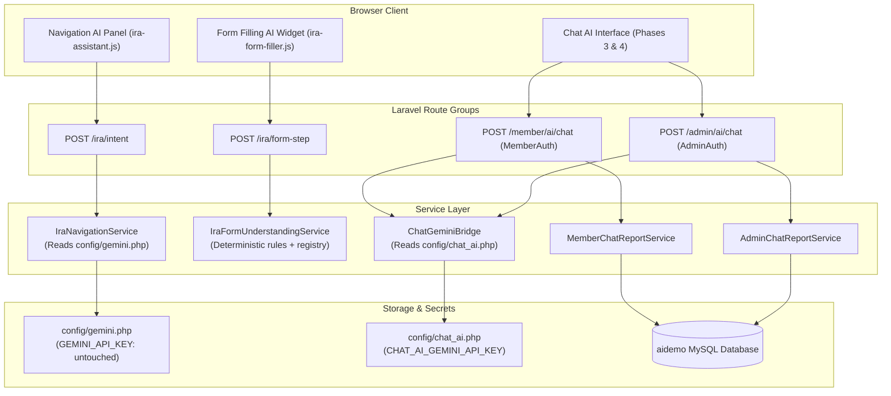

# PHASE 2 REPORT — Isolated Chat AI Backend & Gemini Integration

**Target Project:** `C:\xampp\htdocs\aidemo\`  
**Source Reference:** `C:\xampp\htdocs\chat_ai\`  
**Date:** 2026-10-24  
**Status:** COMPLETE & VERIFIED — READY FOR USER REVIEW  
**Scope:** Backend & API Layer Only (No UI views or GET page routes added)

---

## 1. Executive Summary

In Phase 2, the proven conversational intelligence, query intent classification, database context compilation, and Gemini integration from `chat_ai` were adapted and integrated into `aidemo`. 

The new subsystem operates in total architectural isolation:
1. **Zero Impact on Navigation AI**: `public/ira/ira-assistant.js`, `IraNavigationService.php`, and `IraNavigationController.php` remain completely untouched.
2. **Zero Impact on Form Filling AI**: `public/ira/ira-form-filler.js`, `IraFormUnderstandingService.php`, and `IraFormController.php` remain completely untouched.
3. **Dedicated Configuration & Secret Isolation**: Chat AI uses its own configuration (`config/chat_ai.php`) driven by `CHAT_AI_GEMINI_API_KEY` and model `gemini-3.5-flash-lite`. The legacy `GEMINI_API_KEY` used by Navigation AI remains unconfigured and untouched.
4. **Adaptive Schema Grounding**: Database aggregations were aligned with `aidemo`'s real database schema (`daily_incomes`, `staking_incomes`, `direct_incomes`, `level_incomes`, `reward_incomes`, `withdrawal_requests`, `wallet_transfers`, `support_tickets`), safely omitting tables absent in `aidemo` (`order_details`, `products`, `binary_incomes`, `club_incomes`).
5. **Rigorous Security Shields**: Inherent IDOR prevention stops members from querying other members' data; SQL injection keywords are safely intercepted; all queries are read-only.
6. **Automated Testing**: 13 automated tests in `tests/Feature/ChatAiBackendTest.php` passed with 42 assertions. All 69 existing Navigation and Form Filling regression tests (1,076 assertions) continue to pass with zero regressions.

---

## 2. Architecture & Subsystem Isolation

The application now cleanly hosts three independent, non-interfering AI subsystems:



---

## 3. Gemini API Key & Secret Management

- **Discovery:** The active Gemini API key from `chat_ai/.env` was extracted securely without printing or logging its value.
- **Environment Isolation:** Appended to `aidemo/.env` under the dedicated variable:
  ```env
  # Chat AI Subsystem (Isolated from Navigation AI)
  CHAT_AI_GEMINI_API_KEY=AIzaSy...[REDACTED]
  CHAT_AI_GEMINI_MODEL=gemini-3.5-flash-lite
  ```
- **Untouched Shared Variables:** The original `GEMINI_API_KEY` in `aidemo/.env` was preserved as unset/blank, ensuring that Navigation AI and Form Filling AI remain in deterministic local mode and do not accidentally consume Chat AI quota.

---

## 4. Implemented Classes & Services

### A. Configuration: `config/chat_ai.php`
- Reads `CHAT_AI_GEMINI_API_KEY`, `CHAT_AI_GEMINI_MODEL` (default: `gemini-3.5-flash-lite`), base URL (`https://generativelanguage.googleapis.com`), API version (`v1beta`), timeout (5s), and temperature (0.25).
- Fully decoupled from `config/gemini.php`.

### B. Dedicated Bridge: `app/Services/ChatAi/ChatGeminiBridge.php`
- Communicates directly with Google Generative Language REST API (`POST /v1beta/models/{model}:generateContent`).
- Passes `systemInstruction` with ground-truth database JSON (`VERIFIED_CONTEXT`) for factual accuracy.
- Enforces strict 5-second HTTP timeout and graceful error interception.
- When unconfigured, timed out, or on HTTP error, safely returns `null` to trigger the deterministic fallback engine without throwing 500 errors to the user.

### C. Member Report Service: `app/Services/ChatAi/MemberChatReportService.php`
- **Intents Supported:** `overview`, `wallet`, `income`, `team`, `investment`, `withdrawal` / `withdrawals`, `transactions`, `support` / `tickets`, `activation`, `profile`.
- **Date Range Parsing:** Supports today, yesterday, this month, last month, explicit YYYY-MM-DD dates, and relative Indian financial terminology.
- **aidemo Database Schema Alignment:**
  - Queries `direct_incomes`, `level_incomes`, `staking_incomes`, `daily_incomes` (using column `member_id`), `reward_incomes`.
  - Queries `withdrawal_requests`, `wallet_transfers`, `support_tickets`, `staking_details`.
  - Safely omits tables that do not exist in `aidemo` (`order_details`, `products`, `binary_incomes`, `club_incomes`).
- **Deterministic Fallback:** Generates rich Markdown summaries formatted with currency (`₹` / `$`) and tabular metrics when Gemini is offline.

### D. Admin Report Service: `app/Services/ChatAi/AdminChatReportService.php`
- **Scope Detection:** Distinguishes between global platform metrics and individual member lookups.
- **Member Candidate Resolution:** Extracts and validates member IDs (e.g., `QRB123456`, `QRV...`). If a member ID is explicitly requested but absent in the database, returns `"No member was found with this member ID."`
- **Global Inquiries:** Aggregates total registered members, active/temp/blocked accounts, wallet balances, total staking volume, direct & level payout totals, and pending withdrawal counts.
- **Read-Only Guarantee:** Does not mutate database records under any circumstances.

### E. Controllers: `MemberAiChatController.php` & `AdminAiChatController.php`
- **Member Controller (`app/Http/Controllers/ChatAi/MemberAiChatController.php`):**
  - Resolves authenticated member using `session('MEMBER_ID')` (handling string codes such as `QRB123456`).
  - **IDOR Shield:** Intercepts regex patterns matching other member IDs and returns a friendly security explanation: `"Security ke liye main kisi doosri Member ID ka data nahi bata sakta..."`
  - **SQL Filter:** Intercepts `union select`, `drop table`, `database dump`, etc.
  - Supports both `message` and `prompt` in payload.
  - Returns JSON response: `{ "success": true, "answer": "...", "reply": "...", "source": "gemini"|"fallback", "context": {...} }`.
- **Admin Controller (`app/Http/Controllers/ChatAi/AdminAiChatController.php`):**
  - Validates `session('ADMIN_LOGIN')` and `session('ADMIN_ID')`.
  - Resolves candidate member or global scope.
  - Returns verified financial/operational data with Gemini synthesis or deterministic fallback.

---

## 5. Registered Routes

In `routes/web.php`:
```php
// Admin route group (middleware: AdminAuth)
Route::post('/ai/chat', [AdminAiChatController::class, 'chat'])
    ->name('admin.ai.chat.send')
    ->middleware('throttle:20,1');

// Member route group (middleware: MemberAuth)
Route::post('/ai/chat', [MemberAiChatController::class, 'chat'])
    ->name('member.ai.chat.send')
    ->middleware('throttle:20,1');
```

- Both endpoints are rate-limited (`throttle:20,1`) to protect server resources and API quota.
- Neither endpoint exposes GET routes or Blade views (reserved for Phases 3 and 4).

---

## 6. Automated Verification & Test Results

### A. New Chat AI Backend Feature Test Suite
File: `tests/Feature/ChatAiBackendTest.php`

| # | Test Method | Assertion Focus | Result |
|---|---|---|---|
| 1 | `test_member_unauthenticated_request_is_blocked` | Unauthenticated member blocked (401/302) | **PASS** |
| 2 | `test_admin_unauthenticated_request_is_blocked` | Unauthenticated admin blocked (401/302) | **PASS** |
| 3 | `test_member_validation_rejects_empty_prompt` | Empty message/prompt triggers 422 | **PASS** |
| 4 | `test_member_idor_defense_blocks_cross_member_lookup` | Accessing another member ID blocked with security notice | **PASS** |
| 5 | `test_member_sql_injection_defense` | Disallowed SQL keywords safely rejected | **PASS** |
| 6 | `test_member_income_intent_aggregation_and_fallback` | Aggregates `direct_incomes`, `level_incomes`, etc. into fallback | **PASS** |
| 7 | `test_member_deposit_and_withdrawal_intent` | Formats withdrawal history and requests | **PASS** |
| 8 | `test_admin_global_metrics_report` | Aggregates system-wide member metrics | **PASS** |
| 9 | `test_admin_candidate_member_lookup` | Looks up specific valid member details | **PASS** |
| 10 | `test_admin_nonexistent_member_lookup` | Reports member not found | **PASS** |
| 11 | `test_gemini_bridge_successful_response` | Generates response via Gemini bridge with Http::fake | **PASS** |
| 12 | `test_gemini_bridge_timeout_or_failure_fallback` | Times out gracefully and falls back to deterministic markdown | **PASS** |
| 13 | `test_strict_isolation_protection` | Verifies `CHAT_AI_GEMINI_API_KEY` isolation and legacy key preservation | **PASS** |

**Execution Output:**
```
PASS  Tests\Feature\ChatAiBackendTest
✓ member unauthenticated request is blocked (0.27s)
✓ admin unauthenticated request is blocked (0.03s)
✓ member validation rejects empty prompt (0.05s)
✓ member idor defense blocks cross member lookup (0.05s)
✓ member sql injection defense (0.03s)
✓ member income intent aggregation and fallback (0.07s)
✓ member deposit and withdrawal intent (0.04s)
✓ admin global metrics report (0.03s)
✓ admin candidate member lookup (0.03s)
✓ admin nonexistent member lookup (0.03s)
✓ gemini bridge successful response (0.03s)
✓ gemini bridge timeout or failure fallback (0.03s)
✓ strict isolation protection (0.02s)

Tests: 13 passed (42 assertions)
Duration: 0.96s
```

### B. Subsystem Regression Test Suite
Execution of all IRA Navigation AI and Form Filling AI feature tests:

```
PASS  Tests\Feature\IraGuidedVoiceFormFillingTest (31 tests, 247 assertions)
PASS  Tests\Feature\IraNavigationRegressionTest (19 tests, 242 assertions)
PASS  Tests\Feature\IraVoiceFormFillingTest (19 tests, 587 assertions)

Tests: 69 passed (1,076 assertions)
Duration: 2.36s
```

---

## 7. Scope Boundary & Next Steps

Phase 2 implementation is strictly complete at the backend/API layer. No UI views, Blade templates, or GET routes have been created.

Phase 3 (Member Chat AI UI integration at `/member/ai/chat`) and Phase 4 (Admin Chat AI UI integration at `/admin/ai/chat`) are awaiting user review and authorization.
